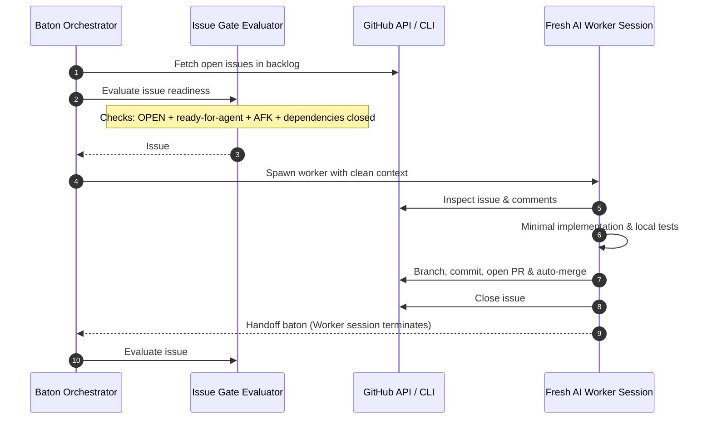

# Sandcastle

**Autonomous, sequential GitHub issue baton orchestrator for AI coding agents.**

Sandcastle eliminates context degradation by enforcing a **single-issue context boundary**: each issue is assigned to an isolated worker session with a completely clean context window, verified against project tests, committed, merged via Pull Request, and closed before passing the baton to the next issue.

---

## ⚡ The Problem: Context Degradation

When an AI coding agent attempts to work through a multi-issue backlog in a single persistent session:
- **Token Degradation**: Context windows bloat, increasing cost and response latency.
- **Hallucinations & Drift**: Early requirements and test outputs pollute reasoning for subsequent tasks.
- **Regression Risk**: Cumulative untracked side effects accumulate across issues.

### The Sandcastle Solution: The Sequential Baton



---

## 🚀 Quick Start

### 1. Global CLI (Interactive Wizard)

Run `sandcastle` or `sc` in any Git repository:

```bash
# Launch interactive terminal wizard
sandcastle
```

The wizard guides you through repository confirmation, pre-flight environment checks, open issue selection, model and reasoning settings, and live execution.

### 2. Headless CLI Execution

Execute specific issues or entire backlogs in non-interactive / CI environments:

```bash
# Process a single issue
sandcastle run 10

# Process all open ready issues in backlog
sandcastle run --all

# Run with specific model and reasoning effort
sandcastle run --all --model "gemini-2.5-pro" --effort high

# Headless JSON output for pipeline automation
sandcastle run 10 --json
```

### 3. Antigravity Skill (In-Session Subagent Orchestrator)

Inside an active Google Antigravity session (CLI, IDE, or App), trigger the baton directly:

```text
Use sandcastle on owner/repo starting at issue #10
```

The coordinator agent will spawn isolated subagents (`invoke_subagent`) for each issue sequentially.

### 4. PowerShell CLI (`sandcastle.ps1`)

```powershell
.\sandcastle.ps1 -Repo "owner/repo" -StartIssue 10
```

---

## 🛠️ Global CLI Reference (`sandcastle` / `sc`)

| Command | Description |
| :--- | :--- |
| `sandcastle wizard` (or bare `sandcastle`) | Interactive terminal wizard for guided baton orchestration. |
| `sandcastle run [issue]` | Run headless baton loop (`--all`, `--model`, `--effort`, `--timeout`, `--retries`, `--auto-pr`, `--auto-merge`, `--json`). |
| `sandcastle watch` | Live alternate-screen terminal monitor streaming agent transcripts and progress. |
| `sandcastle status` | Display status snapshot of current or latest baton execution (`--json`). |
| `sandcastle doctor` | Validate workspace health, toolchain (`gh`, `git`, `agy`, Node), and auth. |
| `sandcastle config` | Manage 3-tier configuration (`get`, `set`, `list`). |

---

## 🛡️ Baton Gating & Safety

Sandcastle protects your codebase by strictly evaluating issue prerequisites before launching a worker:

1. **State Gate**: Issue must be `OPEN`.
2. **Specification Gate**: Must have the `ready-for-agent` label.
3. **Authorization Gate**: Must have the `AFK` (or `afk`) label.
4. **Dependency Gate**: All prerequisite blockers (`Blocked by #N` or GitHub sub-issues) must be `CLOSED`.

### Blocker Protocol
If a worker encounters failing tests, ambiguous specifications, or missing credentials:
1. It applies the `status blocked` label.
2. It posts a diagnostic comment with logs and required human intervention.
3. **Execution halts immediately** — the baton will never push forward in a broken state.

---

## 📋 The Worker Contract

Every isolated worker session follows a strict 7-phase contract:

1. **Orient & Inspect**: Read issue body, comments, and project architecture (`gh issue view <N> --comments`).
2. **Minimal Implementation**: Implement only the changes strictly needed for the issue requirements.
3. **Local Verification**: Run project test suites, typechecks, and linters until green.
4. **Branch & Commit**: Create feature branch `issue-<N>-<slug>` and conventional commit referencing `#<N>`.
5. **Pull Request**: Push branch and create PR (`gh pr create`).
6. **Merge**: Auto-merge PR (`gh pr merge --merge`).
7. **Close & Sync**: Close issue with audit summary (`gh issue close <N>`) and sync local `main`.

---

## 📖 Complete Documentation Index

### 👤 User Guides
- [**Getting Started Guide**](file:///C:/Users/Manit/Desktop/sandcastle/docs/user/getting-started.md): Installation, prerequisites, and first baton run.
- [**Interactive Wizard Walkthrough**](file:///C:/Users/Manit/Desktop/sandcastle/docs/user/interactive-wizard.md): In-depth walkthrough of the interactive TUI wizard flow, badges, and phase spinners.
- [**CLI Reference**](file:///C:/Users/Manit/Desktop/sandcastle/docs/user/cli-reference.md): Complete reference for all CLI subcommands, flags, and JSON schemas.
- [**Configuration Guide**](file:///C:/Users/Manit/Desktop/sandcastle/docs/user/configuration.md): Managing defaults across local, global, and CLI tiers.

### 🏛️ Architecture & Core Engine
- [**System Architecture Overview**](file:///C:/Users/Manit/Desktop/sandcastle/docs/architecture/overview.md): System architecture diagram, modular layer breakdown, lifecycle flow, and process safety teardowns.
- [**Baton Orchestrator Deep Dive**](file:///C:/Users/Manit/Desktop/sandcastle/docs/architecture/baton-orchestrator.md): Deep dive into `BatonRunner`, event-driven state machine, queue resolution, and snapshot persistence.
- [**Gating and Safety Engine**](file:///C:/Users/Manit/Desktop/sandcastle/docs/architecture/gating-and-safety.md): Deep dive into `GatingEvaluator`, 4 Baton Gates, dependency regex parser, in-memory graph evaluation, and blocker protocols.
- [**Process Supervision**](file:///C:/Users/Manit/Desktop/sandcastle/docs/architecture/process-supervision.md): Subprocess lifecycle management, dual-tier watchdog timeouts, HTTP 429 quota backoff, and retry loops with feedback injection.
- [**Observability & Monitoring**](file:///C:/Users/Manit/Desktop/sandcastle/docs/architecture/observability.md): Deep dive into `TranscriptTailer` incremental JSONL poller and `WatchMonitor` alternate-screen TUI.

### 🤖 AI Agent Guides
- [**AI Agent Guide: Authoring Issues**](file:///C:/Users/Manit/Desktop/sandcastle/docs/agents/issue-authoring.md): How AI agents author atomic issues with checkable acceptance criteria and gate labels.
- [**The Worker Contract**](file:///C:/Users/Manit/Desktop/sandcastle/docs/agents/worker-contract.md): Authoritative 7-phase execution protocol and blocker rules.
- [**Antigravity CLI Interoperability**](file:///C:/Users/Manit/Desktop/sandcastle/docs/agents/antigravity-interop.md): Integration with Google Antigravity (`agy`), model resolution, and statusline quota tracking.
- [**Canonical Triage Labels**](file:///C:/Users/Manit/Desktop/sandcastle/docs/agents/triage-labels.md): Five canonical triage roles and Sandcastle baton gating labels.
- [**GitHub Issue Tracker Operations**](file:///C:/Users/Manit/Desktop/sandcastle/docs/agents/issue-tracker.md): Managing issues, backlogs, and comments via `gh` CLI.
- [**Domain & Single-Context Architecture**](file:///C:/Users/Manit/Desktop/sandcastle/docs/agents/domain.md): Layout and maintenance of domain documentation (`CONTEXT.md` + `docs/adr/`).
- [**`CONTEXT.md`**](file:///C:/Users/Manit/Desktop/sandcastle/CONTEXT.md): Domain model and conceptual glossary.
- [**`AGENTS.md`**](file:///C:/Users/Manit/Desktop/sandcastle/AGENTS.md): Agent guidelines and skill mappings.

### 💻 Developer Reference
- [**Contributor Guide**](file:///C:/Users/Manit/Desktop/sandcastle/docs/developer/contributing.md): Development setup, bundling pipeline (`tsup`), test suites (`vitest`), and prepack verification (`verify-build.mjs`).
- [**Programmatic API Reference**](file:///C:/Users/Manit/Desktop/sandcastle/docs/developer/programmatic-api.md): Importing Sandcastle as a TypeScript library, class interfaces, options, and code examples.
- [**Architecture Decision Records (`docs/adr/`)**](file:///C:/Users/Manit/Desktop/sandcastle/docs/adr/): Recorded architectural decisions.
- [**Real-World Demonstration Benchmark**](file:///C:/Users/Manit/Desktop/sandcastle/SESSION_SUMMARY.md): Benchmark report and autonomous multi-issue demonstration run.

---

## 📄 License

MIT © Sandcastle Contributors
