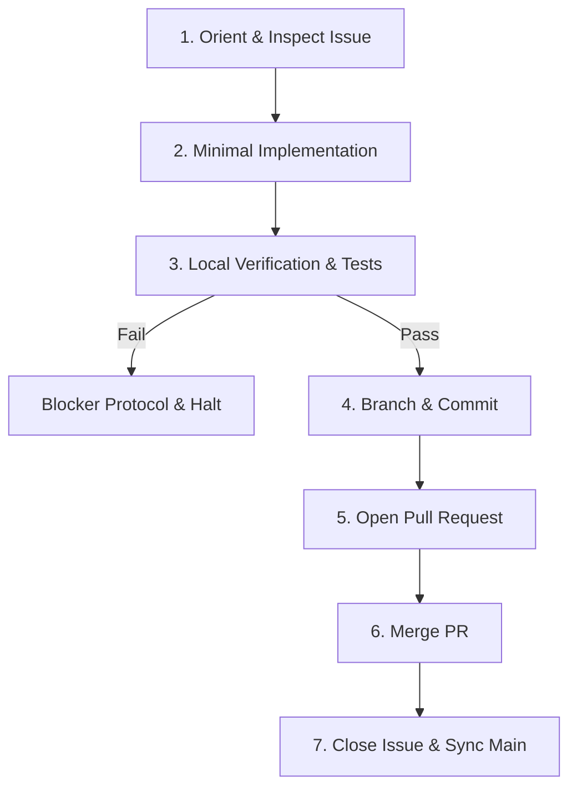

# Authoring Issues & Working with Sandcastle

Guide for AI agents creating backlog issues, managing triage gates, and executing tasks within the Sandcastle autonomous issue baton system.

---

## 1. System Overview: The Baton Model

Sandcastle operates on **isolated sequential execution**:
- **One Issue, One Session**: Each issue is picked up by a fresh AI worker session with a clean context window.
- **No Context Bloat**: Cross-issue token degradation and hallucinations are eliminated.
- **Baton Handoff**: An issue must be implemented, verified with tests, merged via Pull Request, and closed before the baton advances to the next issue.
- **Strict Gating**: Workers only execute issues that satisfy explicit readiness and authorization gates.

---

## 2. Issue Authoring Standard

When an AI agent decomposes requirements, plans a feature, or files bug reports for Sandcastle, it must author **atomic, self-contained, and testable** issues.

### Atomicity & Scope
- **Single Objective**: Scope each issue to a single verifiable behavior, component, or bug fix.
- **Sequencing Over Mega-Issues**: Break multi-step features into a chain of small issues linked by dependencies rather than a single massive ticket.
- **Minimal Surface**: Limit the blast radius to the files directly required for the objective.

### Required Issue Sections

Every issue filed for Sandcastle must contain the following 4 sections:

```markdown
## Objective
A concise 1-2 sentence description of what must be built or fixed and why.

## Acceptance Criteria
Checkable, observable requirements using markdown checkboxes:
- [ ] Explicit behavior or API contract fulfilled
- [ ] Required files created/updated at specific paths
- [ ] CLI flags/options behave as specified
- [ ] Edge cases handled gracefully

## Verification Plan
Exact terminal commands the worker agent must run to verify correctness:
- Automated tests: `npm test -- <test-file>` (or project test command)
- Typecheck: `npm run typecheck`
- Build / Lint: `npm run build` or `npm run lint`

## Dependencies
- `Blocked by #<number>` (or `None`)
```

---

## 3. Baton Gating & Triage Labels

Before a worker picks up an issue, the Sandcastle Gating Evaluator verifies that the issue meets all gating prerequisites.

### The Mandatory Gate Pair

To be processed by Sandcastle, an issue **must** have both:

| Label | Purpose | Applied When |
| :--- | :--- | :--- |
| `ready-for-agent` | Specification gate | Issue has clear objective, checkable acceptance criteria, and verification plan. |
| `AFK` / `afk` | Authorization gate | Human maintainer or planning agent authorizes unattended execution. |

### Complete Triage Label Reference

| Label | Role | Action by Sandcastle |
| :--- | :--- | :--- |
| `needs-triage` | Newly created / unreviewed | Skipped by runner. |
| `needs-info` | Missing details or clarification | Skipped by runner. |
| `ready-for-agent` | Specified for autonomous agent | Evaluated for gate readiness. |
| `AFK` / `afk` | Unattended execution authorized | Evaluated for gate readiness. |
| `ready-for-human` | Requires human implementation | Skipped by runner. |
| `status blocked` | Execution halted on failure | **Halts baton immediately**. |
| `sandcastle` | Managed under Sandcastle baton | Informational tag. |
| `wontfix` | Discarded | Skipped by runner. |

### Applying Labels via GitHub CLI

```bash
# Mark issue as ready for autonomous Sandcastle execution
gh issue edit <number> --add-label "ready-for-agent,AFK"

# Mark issue as blocked
gh issue edit <number> --add-label "status blocked" --remove-label "ready-for-agent"
```

---

## 4. Declaring Issue Dependencies

When issues depend on prior work:

1. **GitHub Native Dependencies (Preferred)**:
   ```bash
   # Add blocker dependency using GitHub database ID
   BLOCKER_ID=$(gh api repos/<owner>/<repo>/issues/<blocker-number> --jq .id)
   gh api --method POST repos/<owner>/<repo>/issues/<child-number>/dependencies/blocked_by -F issue_id=$BLOCKER_ID
   ```
2. **Body Text Fallback**:
   Include a line at the top or in the Dependencies section:
   ```markdown
   Blocked by: #12, #13
   ```

Sandcastle will automatically wait for blocker issues to be `CLOSED` before allowing a child issue to pass the gate.

---

## 5. The Worker Contract (Execution Steps)

When an AI worker is dispatched for an issue, it must strictly follow this 7-step sequence:



### 1. Orient & Inspect
- Fetch full issue context and comments:
  ```bash
  gh issue view <number> --comments
  ```
- Inspect target source files and existing test suites.

### 2. Minimal Implementation
- Implement the minimal code strictly needed to satisfy the acceptance criteria.
- Adhere to domain vocabulary defined in `CONTEXT.md`.
- Do not refactor unrelated files or add unrequested features.

### 3. Local Verification
- Run the verification commands specified in the issue.
- Verify all project test suites, typechecks, and builds pass with zero errors:
  ```bash
  npm test && npm run typecheck && npm run build
  ```

### 4. Git Branch & Conventional Commit
- Create a dedicated feature branch:
  ```bash
  git checkout -b issue-<number>-<short-description>
  ```
- Commit using conventional commit format referencing the issue:
  ```bash
  git add <modified-files>
  git commit -m "feat(#<number>): <short description of change>"
  ```

### 5. Pull Request Creation
- Push the branch and open a PR:
  ```bash
  git push origin issue-<number>-<short-description>
  gh pr create --title "feat(#<number>): <title>" --body "Closes #<number>.\n\n### Summary\n<summary>\n\n### Verification\n- Tests passing: `npm test`\n- Typecheck passing: `npm run typecheck`"
  ```

### 6. PR Merge
- Merge the PR once CI/local checks pass:
  ```bash
  gh pr merge --merge --auto || gh pr merge --merge
  ```

### 7. Issue Closure & Main Sync
- Close the issue with a completion summary comment:
  ```bash
  gh issue close <number> --comment "Resolved and merged in PR. All acceptance criteria and verification tests passed."
  ```
- Switch back to `main` and sync latest state:
  ```bash
  git checkout main
  git pull origin main
  ```

---

## 6. Blocker Protocol (Safety First)

If a worker encounters any of the following conditions:
- Ambiguous or conflicting requirements
- Missing or failing prerequisite issue
- Broken test suite that cannot be resolved within the issue's scope
- Missing credentials or permission errors

The worker **must immediately trigger the Blocker Protocol**:

1. **Apply the Blocked Label**:
   ```bash
   gh issue edit <number> --add-label "status blocked"
   ```
2. **Post Diagnostic Comment**:
   ```bash
   gh issue comment <number> --body "### 🛑 Sandcastle Worker Blocked

**Reason**: <clear explanation of what failed>
**Command Output**:
\`\`\`
<error trace or failure logs>
\`\`\`
**Action Required**: <exact steps a human must take to unblock>"
   ```
3. **Halt Execution**: Stop immediately. Do **not** guess, do not fake test results, and do not advance to the next issue.

---

## 7. Example Issue Template

Below is a reference template that AI agents should use when authoring issues:

```markdown
## Objective
Add `--json` output support to the `sandcastle status` command so downstream CI scripts can consume runtime telemetry.

## Acceptance Criteria
- [ ] `sandcastle status --json` outputs a valid JSON object matching `BatonStatusPayload` schema.
- [ ] Suppresses picocolors ANSI formatting when `--json` flag is provided.
- [ ] Exits with code 0 on success and code 1 when active run is blocked.
- [ ] Existing non-JSON terminal formatting remains unchanged when `--json` is omitted.

## Verification Plan
- [ ] `npm test test/commands/status.test.ts` passes.
- [ ] `npm run typecheck` passes.
- [ ] `npm run build:verify` passes.

## Dependencies
- None
```
