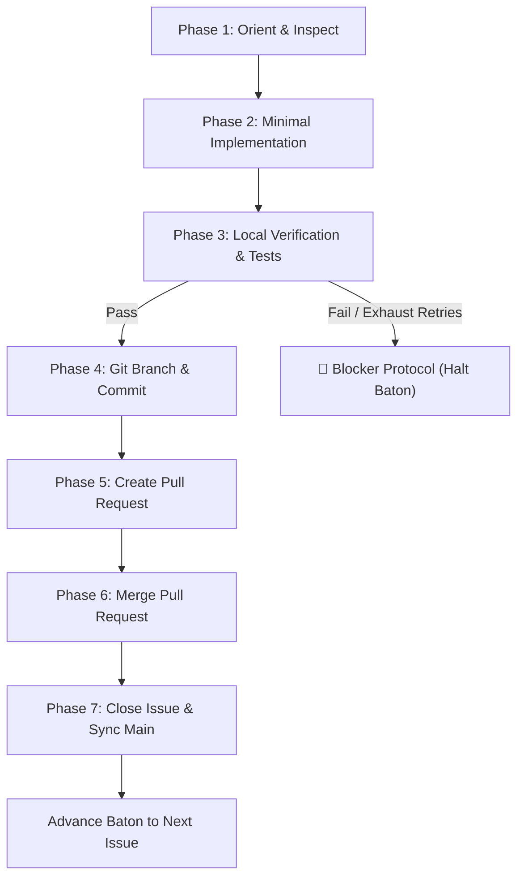
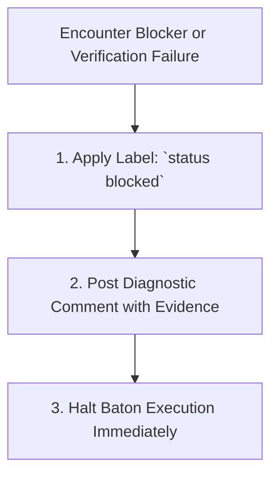

# Sandcastle Worker Contract & Blocker Protocol

The **Worker Contract** is the authoritative, non-negotiable 7-phase execution protocol executed by every autonomous AI agent session dispatched under a Sandcastle **baton**. 

Each worker operates within an isolated context window dedicated strictly to a single issue. The worker is bound to execute all 7 phases sequentially. If any step fails or encounters unresolvable ambiguity, the worker immediately triggers the **Blocker Protocol** and halts.

---

## The 7-Phase Worker Lifecycle



---

## Phase 1: Orient & Inspect

The worker begins by fetching full context and requirements from GitHub and inspecting repository guidance.

### Mandatory Actions:
1. **Fetch Issue Body & Comments**:
   ```bash
   gh issue view <issue-number> --comments
   ```
2. **Inspect Domain Rules & Coding Standards**:
   - Read [`CONTEXT.md`](file:///C:/Users/Manit/Desktop/sandcastle/CONTEXT.md) for domain terminology.
   - Read [`AGENTS.md`](file:///C:/Users/Manit/Desktop/sandcastle/AGENTS.md) for agent behaviors and tooling guidelines.
   - Inspect relevant architecture decision records in [`docs/adr/`](file:///C:/Users/Manit/Desktop/sandcastle/docs/adr/).
3. **Locate Existing Test Suites & Source Files**:
   - Locate test files related to the target component.
   - Identify existing patterns, imports, and mock fixtures.

---

## Phase 2: Minimal Implementation

The worker writes clean, production-grade code that fulfills the acceptance criteria.

### Mandatory Rules:
- **Test-Driven First**: Author or expand test cases reproducing the target behavior before modifying production code where practical.
- **Strict Scope Boundaries**: Limit edits exclusively to files directly required for the issue.
- **Zero Unrelated Refactoring**: Do not rename untouched modules, clean up styling in unrelated files, or alter unrelated tests.
- **Adhere to Domain Glossary**: Use domain terminology defined in [`CONTEXT.md`](file:///C:/Users/Manit/Desktop/sandcastle/CONTEXT.md).

---

## Phase 3: Local Verification

The worker validates that all automated checks pass locally before any git mutation or remote push.

### Verification Checklist:
1. **Unit & Integration Tests**:
   ```bash
   npm test
   # or project-specific test runner:
   # pytest / cargo test / go test
   ```
2. **Typecheck**:
   ```bash
   npm run typecheck
   ```
3. **Build & Package Verification**:
   ```bash
   npm run build
   npm run build:verify
   ```
4. **Git Diff Hygiene**:
   ```bash
   git diff --check
   ```

> [!IMPORTANT]
> The worker must never fake test results, disable existing tests to make a suite pass, or ignore compiler errors. If tests cannot be satisfied, proceed to the [Blocker Protocol](#the-blocker-protocol).

---

## Phase 4: Git Branch & Conventional Commit

Once all local verifications pass with 100% green exit codes, the worker commits the changes to a dedicated feature branch.

### 1. Create Feature Branch
```bash
git checkout -b issue-<issue-number>-<short-slug>
```
*Example: `git checkout -b issue-42-json-schema-validation`*

### 2. Stage & Commit with Conventional Format
```bash
git add <modified-files>
git commit -m "feat(#<issue-number>): <concise description of solution>"
```
*Example commit: `feat(#42): add structured JSON output schema to status command`*

---

## Phase 5: Create Pull Request

The worker pushes the feature branch and opens a GitHub Pull Request linking to the issue.

### 1. Push Branch to Origin
```bash
git push origin issue-<issue-number>-<short-slug>
```

### 2. Open Pull Request
```bash
gh pr create \
  --title "feat(#<issue-number>): <concise title>" \
  --body "Closes #<issue-number>.

### Summary of Changes
- Implemented minimal solution satisfying acceptance criteria.
- Added comprehensive unit tests.

### Verification Performed
- [x] Unit test suite green: \`npm test\`
- [x] Typecheck clean: \`npm run typecheck\`
- [x] Build verified: \`npm run build:verify\`"
```

---

## Phase 6: Pull Request Merge

The worker merges the Pull Request to integrate changes into the base branch.

```bash
gh pr merge --merge --auto || gh pr merge --merge
```

> [!NOTE]
> If the repository enforces squash merging or rebase merging, use `--squash` or `--rebase` according to the repository's branch protection policies.

---

## Phase 7: Close Issue & Sync Main

The worker formally closes the issue in GitHub with an audit log comment, cleans up local state, and syncs the main branch for the next baton handoff.

### 1. Close GitHub Issue with Audit Comment
```bash
gh issue close <issue-number> --comment "Completed autonomously via Sandcastle baton. Verified green test suite and merged in Pull Request."
```

### 2. Return to Main Branch & Pull Latest
```bash
git checkout main
git pull origin main
```

---

## The Blocker Protocol

If a worker encounters any condition that prevents safe, verified autonomous completion, it **must immediately execute the Blocker Protocol and halt**.



### Trigger Conditions
- Missing or ambiguous acceptance criteria that require maintainer clarification.
- Gating prerequisites not satisfied (e.g. dependent issue remains open).
- Test failures or build errors that cannot be resolved within retry limits.
- Upstream network errors, missing authentication, or git push rejections.

### Blocker Steps:

1. **Apply `status blocked` Label**:
   ```bash
   gh issue edit <issue-number> --add-label "status blocked" --remove-label "ready-for-agent"
   ```

2. **Post Structured Diagnostic Comment**:
   ```bash
   gh issue comment <issue-number> --body "### 🛑 Sandcastle Worker Blocked

**Reason**: <Clear, precise explanation of what failed>

**Diagnostic Output / Error Trace**:
\`\`\`
<Exact command failure, compiler error, or test output>
\`\`\`

**Action Required for Human Maintainer**:
- [ ] <Specific remediation action needed to unblock this ticket>"
   ```

3. **Halt Baton**: The worker exits with code `1`. The Sandcastle orchestrator records the blocked state in `.sandcastle/run.json` and halts the sequential loop to prevent cascaded failures.

---

## Context Pointers & Related Documentation

| Document | Description | Reached When |
| :--- | :--- | :--- |
| [issue-authoring.md](file:///C:/Users/Manit/Desktop/sandcastle/docs/agents/issue-authoring.md) | How to write issues that satisfy worker contract gating requirements. | Creating or refining issues in the backlog. |
| [triage-labels.md](file:///C:/Users/Manit/Desktop/sandcastle/docs/agents/triage-labels.md) | Canonical triage labels and Sandcastle baton gates (`ready-for-agent`, `AFK`, `status blocked`). | Managing labels on GitHub issues. |
| [antigravity-interop.md](file:///C:/Users/Manit/Desktop/sandcastle/docs/agents/antigravity-interop.md) | How Antigravity workers are spawned and configured to execute this contract. | Reviewing agent runtime interoperability. |
| [cli-reference.md](file:///C:/Users/Manit/Desktop/sandcastle/docs/user/cli-reference.md) | Command-line flags governing worker timeouts and retries. | Adjusting worker execution parameters. |
