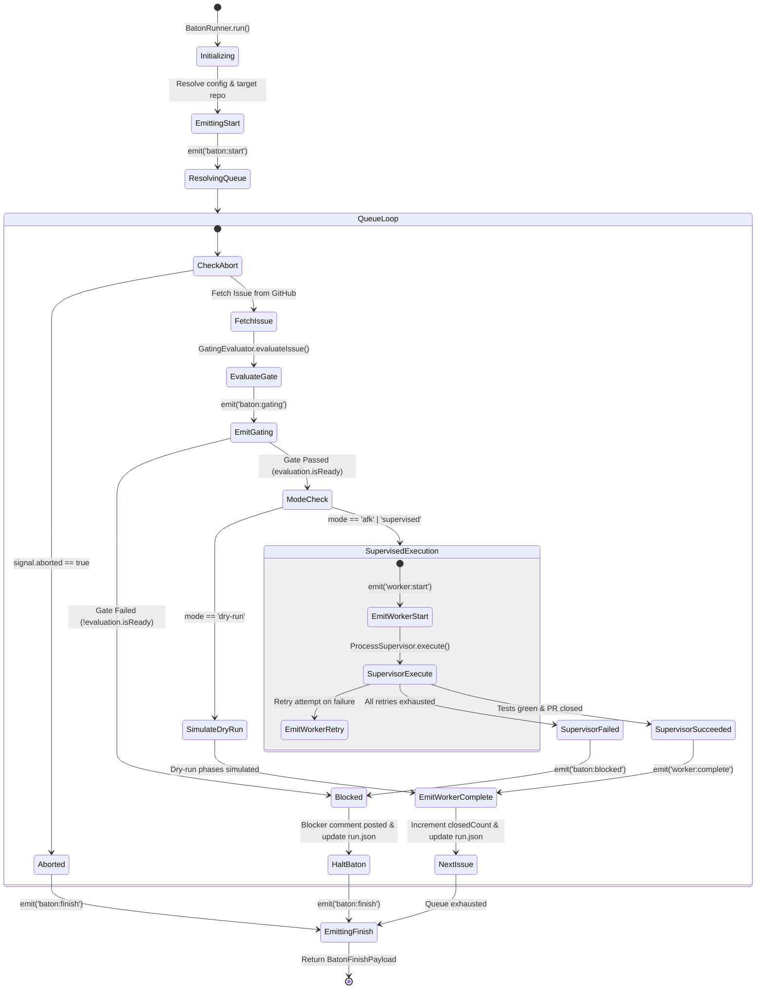
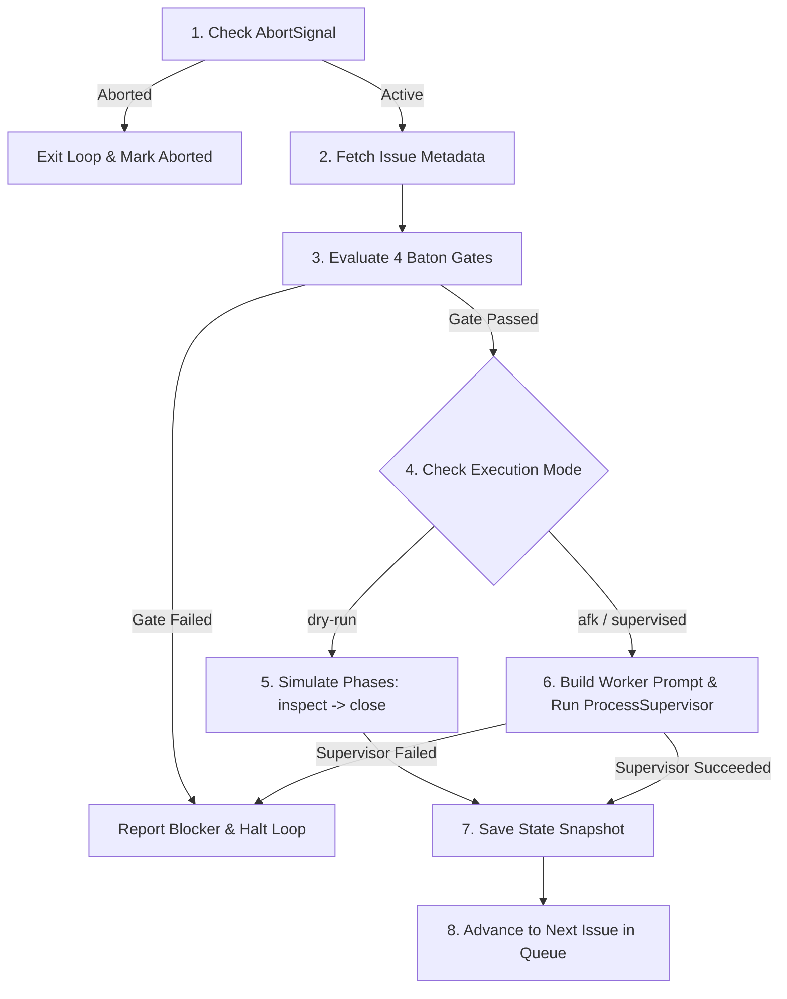

# Baton Orchestrator (`BatonRunner`)

The `BatonRunner` ([`src/core/baton-runner.ts`](file:///C:/Users/Manit/Desktop/sandcastle/src/core/baton-runner.ts)) is the central state machine orchestrating sequential issue execution in Sandcastle. It ensures that an AI coding agent executes issues strictly one at a time, resolving dependencies, enforcing safety gates, and isolating context between tickets.

---

## Context Pointers

| Document | Description | Reached When |
| :--- | :--- | :--- |
| [overview.md](file:///C:/Users/Manit/Desktop/sandcastle/docs/architecture/overview.md) | High-level system architecture and modular layer breakdown. | Seeking structural overview of the engine. |
| [gating-and-safety.md](file:///C:/Users/Manit/Desktop/sandcastle/docs/architecture/gating-and-safety.md) | Deep dive into `GatingEvaluator` and the 4 Baton Gates. | Modifying issue filtering or prerequisite checks. |
| [process-supervision.md](file:///C:/Users/Manit/Desktop/sandcastle/docs/architecture/process-supervision.md) | Subprocess execution, watchdog timers, and retry loops. | Configuring worker prompts, timeouts, or quota handlers. |
| [programmatic-api.md](file:///C:/Users/Manit/Desktop/sandcastle/docs/developer/programmatic-api.md) | TypeScript API reference for `BatonRunner` options and payloads. | Embedding `BatonRunner` into Node.js / TypeScript code. |

---

## Event-Driven State Machine

`BatonRunner` extends Node.js `EventEmitter` and implements typed events via `BatonEventMap` ([`src/types/baton.ts`](file:///C:/Users/Manit/Desktop/sandcastle/src/types/baton.ts)). Every state transition emits a typed payload consumed by the CLI UI, the interactive wizard, or custom programmatic subscribers.



---

## The `BatonEventMap` Typed Interface

All events emitted by `BatonRunner` are strongly typed:

```typescript
export type BatonEventMap = {
  /** Emitted once at the start of a baton run before the first issue is evaluated. */
  'baton:start': (payload: BatonStartPayload) => void;

  /** Emitted when an issue has been evaluated by GatingEvaluator. */
  'baton:gating': (payload: BatonGatingPayload) => void;

  /** Emitted when a worker session starts an execution attempt. */
  'worker:start': (payload: WorkerStartPayload) => void;

  /** Emitted as a worker transitions through contract phases (inspect, implement, test, etc.). */
  'worker:phase': (payload: WorkerPhasePayload) => void;

  /** Emitted when a worker fails an attempt and begins a retry. */
  'worker:retry': (payload: WorkerRetryPayload) => void;

  /** Emitted when a worker successfully completes and closes an issue. */
  'worker:complete': (payload: WorkerCompletePayload) => void;

  /** Emitted when execution is halted due to a gate violation or execution failure. */
  'baton:blocked': (payload: BatonBlockedPayload) => void;

  /** Emitted when the entire baton run finishes (either completed or blocked). */
  'baton:finish': (payload: BatonFinishPayload) => void;
};
```

---

## Sequential Issue Queue Resolution

`BatonRunner` supports two queue resolution strategies:

### 1. Explicit Issue Queue
When explicit issue numbers are provided (e.g., `options.issues = [10, 12, 15]`), `BatonRunner` iterates through the list in the exact specified order.

### 2. Ascending Backlog Scan (`--all`)
When `options.all = true` is passed:
1. `BatonRunner` invokes `GitHubService.listIssues({ state: 'open' })`.
2. The retrieved issues are sorted in ascending numeric order:
   ```typescript
   queue = openIssues.map((i) => i.number).sort((a, b) => a - b);
   ```
3. Issues are processed sequentially. Earlier issue numbers (which generally represent foundational dependencies) are resolved first.

> [!IMPORTANT]
> Sandcastle strictly prohibits concurrent execution across issues. Only **one** worker process runs at any given second, ensuring that Git state, branch references, and repository working directories remain consistent.

---

## Execution Pipeline Per Issue

For each issue in the resolved queue, `BatonRunner` executes the following 8-step pipeline:



### Step 1: Abort Signal Check
Before fetching issue metadata, `BatonRunner` checks if `options.signal?.aborted` is true. If an external caller or process termination signal occurred, the snapshot status is updated to `'aborted'` and the loop breaks immediately.

### Step 2: Fetch Issue Metadata
Fetches the issue title, body, state, labels, and comments via [`GitHubService.getIssue()`](file:///C:/Users/Manit/Desktop/sandcastle/src/services/github-service.ts). If the issue is not found or inaccessible, a blocker event is emitted and execution halts.

### Step 3: Gate Evaluation
Invokes [`GatingEvaluator.evaluateIssue()`](file:///C:/Users/Manit/Desktop/sandcastle/src/core/gating-evaluator.ts) to verify the 4 Baton Gates (`OPEN`, `ready-for-agent`, `AFK`, prerequisite issues `CLOSED`).
- If `!evaluation.isReady`, `BatonRunner` emits `baton:blocked`.
- In non-dry-run mode, it posts a blocker audit comment and applies the `status blocked` label to GitHub via [`GitHubService.reportBlocker()`](file:///C:/Users/Manit/Desktop/sandcastle/src/services/github-service.ts).
- Execution halts to prevent out-of-order changes.

### Step 4: Mode Check (Live vs Dry-Run)
- In `dry-run` mode, `BatonRunner` sequentially emits synthetic `worker:phase` events (`inspect`, `implement`, `test`, `commit`, `pr`, `merge`, `close`), records simulated success, and continues to the next issue.
- In `afk` or `supervised` mode, it initiates live execution.

### Step 5: Worker Prompt Synthesis
`BatonRunner` constructs the initial subagent prompt via `buildDefaultWorkerPrompt()`:
```typescript
export function buildDefaultWorkerPrompt(
  repo: string,
  issueNumber: number,
  issueUrl?: string
): string {
  const url = issueUrl || `https://github.com/${repo}/issues/${issueNumber}`;
  return [
    `You are an autonomous AI coding agent executing a Sandcastle issue baton for issue #${issueNumber}.`,
    '',
    `Issue URL: ${url}`,
    '',
    `Instructions:`,
    `1. Fetch and read the full issue requirements and acceptance criteria using \`gh issue view ${issueNumber} --comments\`.`,
    `2. Inspect the codebase context (CONTEXT.md, AGENTS.md, existing test suites).`,
    `3. Follow the \`implement\` and \`tdd\` skills to write minimal, clean code satisfying the acceptance criteria test-first.`,
    `4. Run all local test suites and linters until 100% green.`,
    `5. Create a git branch \`issue-${issueNumber}-<slug>\`, commit changes with conventional commit messages referencing \`#${issueNumber}\`.`,
    `6. Open a Pull Request referencing \`#${issueNumber}\` using \`gh pr create\`.`,
    `7. Merge the Pull Request using \`gh pr merge --merge\` (or squash).`,
    `8. Close issue \`#${issueNumber}\` with \`gh issue close ${issueNumber} --comment "Completed autonomously via Sandcastle baton. Verified green tests."\`.`,
  ].join('\n');
}
```

### Step 6: Process Supervisor Execution
Executes the worker under [`ProcessSupervisor.execute()`](file:///C:/Users/Manit/Desktop/sandcastle/src/core/process-supervisor.ts). The supervisor handles timeouts, retries, and quota delays.

### Step 7: Outcome & Blocker Short-Circuit
- **On Success**: Emits `worker:complete`, appends issue to `closedIssues`, increments `closedCount`.
- **On Failure**: Emits `baton:blocked`, calls `GitHubService.reportBlocker()` with stderr/stdout evidence, sets `snapshot.status = 'blocked'`, and **breaks out of the loop immediately**.

### Step 8: State Snapshot Persistence (`.sandcastle/run.json`)
After each step, the execution snapshot is persisted to disk at `.sandcastle/run.json`.

---

## State Snapshot Persistence (`.sandcastle/run.json`)

The state file allows detached tools (such as `sandcastle status` and `sandcastle watch`) to inspect live progress.

### Snapshot Schema (`BatonRunSnapshot`):
```json
{
  "sessionId": "baton-1771128530000-a1b2c",
  "startTime": "2026-08-15T04:08:50.000Z",
  "status": "running",
  "repo": "owner/repo",
  "mode": "afk",
  "currentIssue": 42,
  "processedIssues": [
    {
      "number": 41,
      "title": "Implement core tokenizer",
      "status": "completed",
      "durationMs": 45200
    }
  ],
  "totalIssues": 3,
  "closedCount": 1,
  "blockedCount": 0,
  "lastUpdated": "2026-08-15T04:09:35.000Z"
}
```
