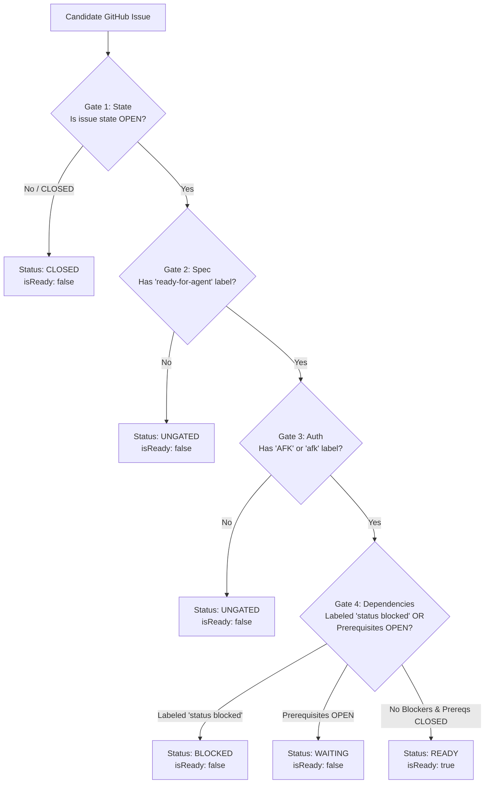

# Baton Gating and Safety Engine (`GatingEvaluator`)

The `GatingEvaluator` ([`src/core/gating-evaluator.ts`](file:///C:/Users/Manit/Desktop/sandcastle/src/core/gating-evaluator.ts)) is Sandcastle's security and dependency evaluation engine. It validates that issues meet strict readiness, authorization, and prerequisite criteria before an AI coding agent is permitted to execute them.

---

## Context Pointers

| Document | Description | Reached When |
| :--- | :--- | :--- |
| [overview.md](file:///C:/Users/Manit/Desktop/sandcastle/docs/architecture/overview.md) | System architecture and modular layer breakdown. | Seeking structural context for gating services. |
| [baton-orchestrator.md](file:///C:/Users/Manit/Desktop/sandcastle/docs/architecture/baton-orchestrator.md) | How `BatonRunner` invokes and reacts to gating evaluations. | Tracing queue progression or blocker short-circuits. |
| [triage-labels.md](file:///C:/Users/Manit/Desktop/sandcastle/docs/agents/triage-labels.md) | Standard triage label semantics and workflows. | Applying or reviewing GitHub issue labels. |
| [issue-authoring.md](file:///C:/Users/Manit/Desktop/sandcastle/docs/agents/issue-authoring.md) | Authoring atomic, gated issues with parseable prerequisites. | Writing new issues for autonomous execution. |

---

## The 4 Baton Gates

To protect codebase integrity and prevent uncoordinated changes, Sandcastle evaluates every candidate issue against four mandatory gates:



### Gate 1: Issue State (`OPEN`)
- **Requirement**: The issue must have `state === 'OPEN'`.
- **Classification if Failed**: `CLOSED`.
- **Rationale**: Prevents re-executing tickets that have already been resolved and closed.

### Gate 2: Specification Gate (`ready-for-agent`)
- **Requirement**: The issue must have the `ready-for-agent` label.
- **Classification if Failed**: `UNGATED`.
- **Rationale**: Ensures human engineers or planning agents have verified the issue has checkable acceptance criteria and complete technical context.

### Gate 3: Authorization Gate (`AFK` / `afk`)
- **Requirement**: The issue must have the `AFK` (or case-insensitive `afk`) label.
- **Classification if Failed**: `UNGATED`.
- **Rationale**: Acts as explicit delegation. Autonomous subagents will never modify code for an issue unless explicitly authorized for unprompted, unattended execution.

### Gate 4: Dependency & Blocker Gate
- **Requirement**:
  1. The issue must NOT contain the `status blocked` label.
  2. All prerequisite blocker issues declared in the issue body must have `state === 'CLOSED'`.
- **Classification if Failed**:
  - If `status blocked` label is present: `BLOCKED`.
  - If prerequisite issues remain open: `WAITING`.
- **Rationale**: Enforces topological dependency ordering. Foundational infrastructure issues must be fully merged before dependent features are executed.

---

## Dependency Regex Parser (`parsePrerequisites`)

Sandcastle parses prerequisite issues declared in the Markdown body of an issue without requiring proprietary issue trackers.

### Regex Specification
[`GatingEvaluator.parsePrerequisites()`](file:///C:/Users/Manit/Desktop/sandcastle/src/core/gating-evaluator.ts) uses a line-anchored, case-insensitive regular expression:

```typescript
const blockerLineRegex =
  /^\s*(?:[-*#>]+\s*)?(?:blocked\s+by|depends\s+on|prerequisites?|requires?)\s*[:=-]?\s*(.*)$/i;
```

### Supported Syntax Variations

The parser extracts numbers from diverse natural markdown patterns:

| Markdown Syntax | Parsed Prerequisite Numbers |
| :--- | :--- |
| `Blocked by: #12` | `[12]` |
| `Depends on #13` | `[13]` |
| `Prerequisites: #14, #15` | `[14, 15]` |
| `- [ ] Blocked by #10, #11, #12` | `[10, 11, 12]` |
| `> Requires: 18, 19` | `[18, 19]` |
| `* Depends on: #21 and #22` | `[21, 22]` |

### Parsing Logic
1. Scans the issue body line-by-line.
2. Identifies matching lead-in keywords (`blocked by`, `depends on`, `prerequisite`, `prerequisites`, `requires`, `require`).
3. Executes a global regex `/#(\d+)|\b(\d+)\b/g` on the remaining text on that line.
4. Aggregates all discovered positive integers into a deduplicated `Set<number>`.

---

## In-Memory Graph Evaluation (`evaluateBacklog`)

When evaluating an entire backlog (e.g. during `sandcastle wizard` or `sandcastle run --all`), querying GitHub for every prerequisite of every issue would result in slow $O(N \times M)$ API queries.

`GatingEvaluator.evaluateBacklog()` eliminates N+1 queries through an in-memory map:

```typescript
async evaluateBacklog(
  issues: GitHubIssue[],
  repo?: string
): Promise<Map<number, GatingEvaluation>> {
  // 1. Build fast in-memory lookup map for all known issues in backlog
  const backlogMap = new Map<number, GitHubIssue>(issues.map((i) => [i.number, i]));
  const evaluationMap = new Map<number, GatingEvaluation>();

  // 2. Evaluate each issue using local backlog lookup first
  for (const issue of issues) {
    const evaluation = await this.evaluateIssue(issue, repo, backlogMap);
    evaluationMap.set(issue.number, evaluation);
  }

  return evaluationMap;
}
```

If a prerequisite issue is found in `backlogMap`, its state is resolved in $O(1)$ memory lookup. If a prerequisite issue is outside the current backlog batch, `GatingEvaluator` falls back to fetching that single issue via `GitHubService.getIssue(prereqNum, repo)`.

---

## Status Classifications & UI Badges

`GatingEvaluation` classifies issues into five canonical statuses:

| Status | `isReady` | Badge Presentation | Meaning |
| :--- | :---: | :--- | :--- |
| **`READY`** | `true` | `[READY]` (Green) | All 4 gates passed. Eligible for immediate worker execution. |
| **`WAITING`** | `false` | `[WAITING]` (Yellow) | Gated and authorized, but waiting for prerequisite issues to close. |
| **`BLOCKED`** | `false` | `[BLOCKED]` (Red) | Marked with `status blocked` label due to previous error or ambiguity. |
| **`UNGATED`** | `false` | `[UNGATED]` (Dim Gray) | Missing `ready-for-agent` and/or `AFK` labels. |
| **`CLOSED`** | `false` | `[CLOSED]` (Dim White) | Issue is already closed in GitHub. |

### Evaluation Payload Interface (`GatingEvaluation`)
```typescript
export interface GatingEvaluation {
  issueNumber: number;
  title: string;
  state: 'OPEN' | 'CLOSED';
  status: GatingStatus;
  isReady: boolean;
  hasReadyLabel: boolean;
  hasAfkLabel: boolean;
  isBlockedLabelPresent: boolean;
  missingLabels: string[];
  prerequisiteIssueNumbers: number[];
  blockingIssueNumbers: number[];
  reasons: string[];
}
```

---

## Blocker Reporting Protocol (`reportBlocker`)

When an issue fails gate evaluation during an active baton run or when a worker subprocess fails after retries, Sandcastle executes the **Blocker Protocol** via [`GitHubService.reportBlocker()`](file:///C:/Users/Manit/Desktop/sandcastle/src/services/github-service.ts):

1. **Applies Blocker Label**:
   Adds the `status blocked` label to the issue in GitHub.
2. **Posts Diagnostic Audit Comment**:
   Appends a structured markdown comment providing full diagnostic context:

```markdown
## 🚫 Sandcastle Baton Blocked

**Reason:** Missing required gate labels: ready-for-agent, AFK

### Evidence / Output
```
Gating check failed: Issue #42 is missing label 'ready-for-agent'
```

### Remediation
Ensure issue is OPEN and has labels 'ready-for-agent' and 'AFK'.

---
_Sandcastle autonomous execution halted to protect repository integrity._
```

3. **Immediate Baton Short-Circuit**:
   `BatonRunner` terminates the queue loop immediately. Sandcastle will never skip over a blocked issue to process subsequent tickets out-of-order.
