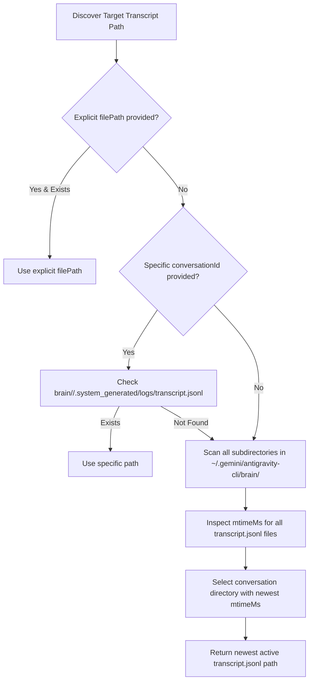
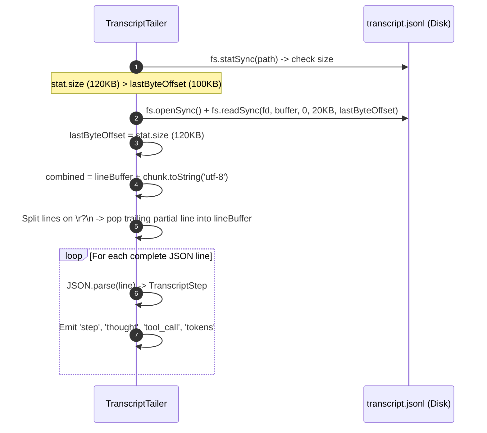

# Observability and Live Monitoring

Sandcastle provides real-time observability into autonomous agent execution through two core components:
1. **[`TranscriptTailer`](file:///C:/Users/Manit/Desktop/sandcastle/src/core/transcript-tailer.ts)**: An incremental JSONL log tailer that extracts planner thoughts, tool invocations, and token metrics from Antigravity sessions.
2. **[`WatchMonitor`](file:///C:/Users/Manit/Desktop/sandcastle/src/ui/watch-monitor.ts)**: An alternate-screen terminal UI dashboard rendering live execution status, phase progress, reasoning thoughts, and active tool calls.

---

## Context Pointers

| Document | Description | Reached When |
| :--- | :--- | :--- |
| [overview.md](file:///C:/Users/Manit/Desktop/sandcastle/docs/architecture/overview.md) | High-level system architecture and modular layer breakdown. | Seeking structural context. |
| [process-supervision.md](file:///C:/Users/Manit/Desktop/sandcastle/docs/architecture/process-supervision.md) | Subprocess management and quota rate limit handling. | Understanding how workers run under the hood. |
| [cli-reference.md](file:///C:/Users/Manit/Desktop/sandcastle/docs/user/cli-reference.md) | Subcommands and flags for `sandcastle watch` and `sandcastle status`. | Using the monitoring CLI commands. |
| [programmatic-api.md](file:///C:/Users/Manit/Desktop/sandcastle/docs/developer/programmatic-api.md) | TypeScript API reference for `TranscriptTailer` and `WatchMonitor`. | Integrating real-time streaming into custom UIs. |

---

## JSONL Transcript Stream Discovery

Google Antigravity sessions write real-time structured execution events to JSONL log files within the user's application data directory:

```text
~/.gemini/antigravity-cli/brain/<conversation-id>/.system_generated/logs/transcript.jsonl
```

### Auto-Discovery Algorithm
[`TranscriptTailer.discoverTranscriptPath()`](file:///C:/Users/Manit/Desktop/sandcastle/src/core/transcript-tailer.ts) resolves the target log file without requiring manual path entry:



1. Checks if an explicit `filePath` was supplied and exists.
2. Checks if a specific `conversationId` directory exists.
3. Otherwise, scans `brain/*/` subdirectories, inspects file modification timestamps (`mtimeMs`), and automatically selects the most recently updated active transcript.

---

## Incremental Byte Offset Polling

Rather than reading entire multi-megabyte log files on every refresh, `TranscriptTailer` implements low-overhead incremental random-access file polling:



### Key Technical Details:
- **Default Poll Interval**: `300ms` (`pollIntervalMs`).
- **Partial Line Protection**: If a log line is currently being written when a poll occurs, the trailing fragment is preserved in `this.lineBuffer` and prepended to the next chunk.
- **Random Access**: Only newly appended bytes (`stat.size - this.lastByteOffset`) are read using `fs.readSync`.

---

## Stream Events and Data Extraction

As JSON lines are parsed, `TranscriptTailer` categorizes and emits structured domain events:

### 1. `step` Event
Emits the full raw `TranscriptStep` object containing step index, type, status, and timestamp.

### 2. `thought` Event
Extracts the agent's internal planning thoughts and reasoning tokens. It strips XML wrapping tags (`<thought>...</thought>`) and heading markdown (`# Thinking`) to provide clean text strings.

### 3. `tool_call` Event
Parses tool invocations (`name`, `args`, `action`, `summary`, `status`) and stores them in a **50-entry circular buffer** (`recentToolCalls`) for dashboard presentation.

```typescript
export interface ParsedToolCall {
  stepIndex: number;
  timestamp: string;
  name: string;
  args: Record<string, any>;
  summary?: string;
  action?: string;
  status: 'running' | 'completed' | 'error';
  resultPreview?: string;
}
```

### 4. `tokens` Event
Tracks model token consumption (`input`, `output`, `total`) as reported in step metadata.

---

## Alternate-Screen TUI Rendering (`WatchMonitor`)

The `WatchMonitor` ([`src/ui/watch-monitor.ts`](file:///C:/Users/Manit/Desktop/sandcastle/src/ui/watch-monitor.ts)) renders a full-screen, live dashboard using ANSI terminal control escape sequences:

```text
 SANDCASTLE  LIVE WATCH MONITOR   [Elapsed: 02:45]
────────────────────────────────────────────────────────────────────────
   RUNNING   Repo: owner/repo  Session: baton-1771128530000-a1b2c
  Active: Issue #42  │  Progress: 2/5 closed (0 blocked)  ████░░░░░░ 40%

  Worker Contract: [Inspect] → [Implement] → [Test] → [Commit] → [PR] → [Merge] → [Close]
────────────────────────────────────────────────────────────────────────
┌─ Agent Live Reasoning ────────────────────────────────────────────────┐
│ Inspecting test/parser.test.ts to verify regex edge cases...           │
│ Adding test cases for multi-number prerequisite declarations...        │
└───────────────────────────────────────────────────────────────────────┘

┌─ Recent Tool Calls ───────────────────────────────────────────────────┐
│ ✔ view_file(parser.ts) - Inspect existing prerequisite parsing logic   │
│ ✔ replace_file_content(parser.ts) - Update line-anchored regex pattern  │
│ ● run_command(npm test) - Running vitest test suite                    │
└───────────────────────────────────────────────────────────────────────┘

  Model: Gemini 3.7 Flash (High)  │  Quota: ████████ 100%  │  Tokens: 14250
────────────────────────────────────────────────────────────────────────
  [q] Detach / Quit   [r] Refresh   Auto-updating every 500ms
```

### Terminal Control Codes
- **Enter Alternate Screen**: `\x1b[?1049h\x1b[H\x1b[?25l` (switches to alt-buffer, moves cursor to top-left, hides cursor).
- **Home & Repaint**: `\x1b[H\x1b[2J` (resets cursor to row 1, col 1 and redraws complete frame without terminal flickering).
- **Exit Alternate Screen**: `\x1b[?1049l\x1b[?25h` (restores primary screen buffer and shows cursor).

### Keyboard Navigation & Hotkeys
- **`q` / `Q` / `Ctrl+C`**: Detaches cleanly from the monitor, exits the alternate screen buffer, and restores primary terminal output without interrupting background execution.
- **`r` / `R`**: Triggers an immediate redraw.
