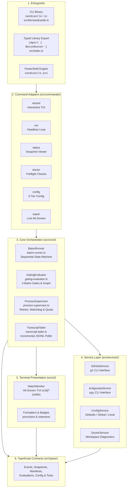
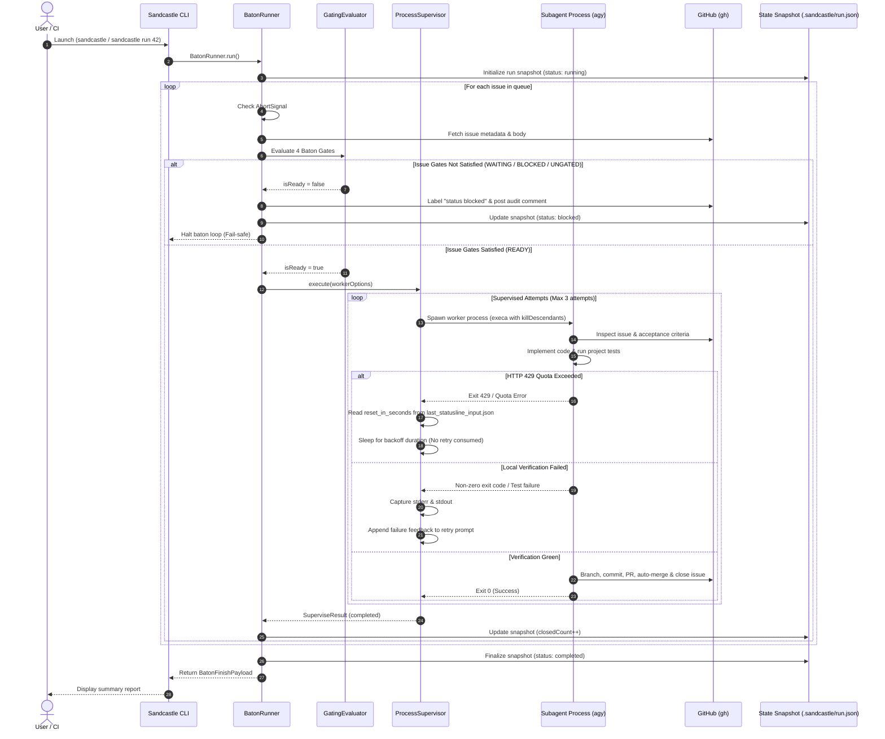

# Architecture Overview

Sandcastle is an autonomous, sequential GitHub issue **baton** orchestrator designed for AI coding agents. It enforces a strict **single-issue context boundary**: every issue is assigned to an isolated worker session with a clean context window, verified against test suites, committed, merged via Pull Request, and closed before passing the baton to the next issue.

---

## Context Pointers

| Document | Description | Reached When |
| :--- | :--- | :--- |
| [baton-orchestrator.md](file:///C:/Users/Manit/Desktop/sandcastle/docs/architecture/baton-orchestrator.md) | Deep dive into `BatonRunner` state machine and queue resolution. | Understanding the sequential issue dispatch lifecycle. |
| [gating-and-safety.md](file:///C:/Users/Manit/Desktop/sandcastle/docs/architecture/gating-and-safety.md) | Deep dive into `GatingEvaluator`, 4 Baton Gates, and blocker protocols. | Auditing security gates or dependency graphs. |
| [process-supervision.md](file:///C:/Users/Manit/Desktop/sandcastle/docs/architecture/process-supervision.md) | Deep dive into `ProcessSupervisor`, watchdog timers, and HTTP 429 quota backoff. | Debugging subagent execution, retries, or rate limits. |
| [observability.md](file:///C:/Users/Manit/Desktop/sandcastle/docs/architecture/observability.md) | Deep dive into `TranscriptTailer` and `WatchMonitor` alternate-screen TUI. | Streaming live agent thoughts, tool calls, and tokens. |
| [programmatic-api.md](file:///C:/Users/Manit/Desktop/sandcastle/docs/developer/programmatic-api.md) | Complete TypeScript API reference for importing Sandcastle as a library. | Integrating Sandcastle into external agent frameworks. |

---

## System Architecture

---

## Modular Layer Breakdown

The Sandcastle codebase is organized into six distinct architectural layers:

### 1. Entrypoints ([`src/bin/sandcastle.ts`](file:///C:/Users/Manit/Desktop/sandcastle/src/bin/sandcastle.ts), [`src/index.ts`](file:///C:/Users/Manit/Desktop/sandcastle/src/index.ts))
- **CLI Executable**: Bundled with a normalized LF shebang (`#!/usr/bin/env node`), registered globally as both `sandcastle` and `sc`.
- **TTY Auto-Dispatch**: If invoked without CLI flags in an interactive terminal, `sandcastle.ts` automatically dispatches to the interactive terminal wizard; otherwise, Commander parses arguments and displays `--help`.
- **Typed Library**: Pure ESM module exporting all core classes, services, UI monitors, and TypeScript definitions.

### 2. Command Adapters ([`src/commands/`](file:///C:/Users/Manit/Desktop/sandcastle/src/commands/))
- **`wizard.ts`**: Interactive terminal wizard powered by `@clack/prompts`, walking through preflights, issue selection with gate badges, model selection with live quota, and multi-phase execution spinners.
- **`run.ts`**: Headless CLI runner supporting single issue targeting or `--all` backlog processing with structured `--json` streaming.
- **`status.ts`**: Non-interactive snapshot viewer displaying the state of the active or most recent baton execution from `.sandcastle/run.json`.
- **`doctor.ts`**: Preflight diagnostic suite verifying Node.js version, Git repository health, `gh` auth status, `agy` availability, and workspace documentation assets.
- **`config.ts`**: Getter, setter, and inspector for 3-tier configuration hierarchy (`defaults` -> `global` -> `local` -> `cli`).
- **`watch.ts`**: Live alternate-screen terminal monitor streaming agent thoughts, tool calls, token usage, and issue progress.

### 3. Core Orchestration Engine ([`src/core/`](file:///C:/Users/Manit/Desktop/sandcastle/src/core/))
- **[`BatonRunner`](file:///C:/Users/Manit/Desktop/sandcastle/src/core/baton-runner.ts)**: Event-driven orchestrator managing the issue queue, evaluating gates, dispatching worker sessions, handling dry-runs, and persisting run state.
- **[`GatingEvaluator`](file:///C:/Users/Manit/Desktop/sandcastle/src/core/gating-evaluator.ts)**: 4-gate verification engine that inspects issue state, labels, and prerequisite markdown dependencies in-memory to prevent premature execution.
- **[`ProcessSupervisor`](file:///C:/Users/Manit/Desktop/sandcastle/src/core/process-supervisor.ts)**: Subprocess supervisor enforcing dual-tier timeouts, up to 2 retries with feedback injection, and non-destructive HTTP 429 quota backoff.
- **[`TranscriptTailer`](file:///C:/Users/Manit/Desktop/sandcastle/src/core/transcript-tailer.ts)**: Incremental JSONL stream poller extracting planner thoughts, tool invocations (in a 50-item circular buffer), and token counts.

### 4. Service Layer ([`src/services/`](file:///C:/Users/Manit/Desktop/sandcastle/src/services/))
- **[`GitHubService`](file:///C:/Users/Manit/Desktop/sandcastle/src/services/github-service.js)**: Wrapper around GitHub CLI (`gh`) for repository resolution, issue querying, labeling, comment posting, PR creation, PR merging, and blocker auditing.
- **[`AntigravityService`](file:///C:/Users/Manit/Desktop/sandcastle/src/services/antigravity-service.ts)**: Wrapper around Google Antigravity (`agy`) CLI for model discovery, alias resolution, statusline inspection (`last_statusline_input.json`), and worker process spawning.
- **[`ConfigService`](file:///C:/Users/Manit/Desktop/sandcastle/src/services/config-service.ts)**: File-based JSON configuration loader resolving global (`~/.sandcastle/config.json`) and local (`.sandcastle/config.json`) tiers.
- **[`DoctorService`](file:///C:/Users/Manit/Desktop/sandcastle/src/services/doctor-service.ts)**: Diagnostic engine executing structured health checks across the host environment.

### 5. Terminal Presentation ([`src/ui/`](file:///C:/Users/Manit/Desktop/sandcastle/src/ui/))
- **[`WatchMonitor`](file:///C:/Users/Manit/Desktop/sandcastle/src/ui/watch-monitor.ts)**: Alternate-screen TUI driver rendering live dashboards, progress gauges, ANSI reasoning boxes, and keyboard event loops.
- **[`formatters.ts`](file:///C:/Users/Manit/Desktop/sandcastle/src/ui/formatters.ts)**: Pure presentation helpers formatting gating badges, model quotas, durations, progress bars, and phase messages.

### 6. TypeScript Contracts ([`src/types/`](file:///C:/Users/Manit/Desktop/sandcastle/src/types/))
- Strongly typed domain contracts including `BatonEventMap`, `BatonRunSnapshot`, `GatingEvaluation`, `SupervisorEvent`, `TranscriptStep`, and `DoctorReport`.

---

## End-to-End Lifecycle Flow

---

## Process Safety & Teardown Protocol

Sandcastle is designed for fully autonomous AFK execution. It implements multi-layered process safety guarantees to ensure no orphaned processes or corrupted terminal states remain:

### 1. Process Tree Termination (`killDescendants: true`)
All subprocess invocations via `execa` in [`AntigravityService`](file:///C:/Users/Manit/Desktop/sandcastle/src/services/antigravity-service.ts) and [`ProcessSupervisor`](file:///C:/Users/Manit/Desktop/sandcastle/src/core/process-supervisor.ts) set `killDescendants: true`. When a worker process times out, errors, or receives an abort signal, the entire child process tree (including compilers, test runners, and node instances) is terminated.

### 2. Signal Trapping and Escalation
[`ProcessSupervisor`](file:///C:/Users/Manit/Desktop/sandcastle/src/core/process-supervisor.ts) and [`WatchMonitor`](file:///C:/Users/Manit/Desktop/sandcastle/src/ui/watch-monitor.ts) register signal traps for `SIGINT` (Ctrl+C), `SIGTERM`, and process `exit`:
- **Graceful Phase**: Upon receiving `SIGINT` or `SIGTERM`, an `AbortController` triggers `signal_abort`, requesting the worker subprocess to gracefully wind down.
- **Escalation Window**: A 5000ms timer (`escalationGracePeriodMs`) begins. If the subprocess does not exit within 5 seconds, Sandcastle forces an immediate process termination (`process.exit(130)`).

### 3. Terminal State & Cursor Restoration
When running interactive wizards or the live watch monitor:
- Cursor visibility is hidden using `\x1b[?25l`.
- Alternate screen buffer is entered using `\x1b[?1049h`.
- Upon any exit, signal trap, unhandled exception, or clean termination, Sandcastle restores the cursor with `\x1b[?25h` and returns to the primary screen buffer with `\x1b[?1049l`.
