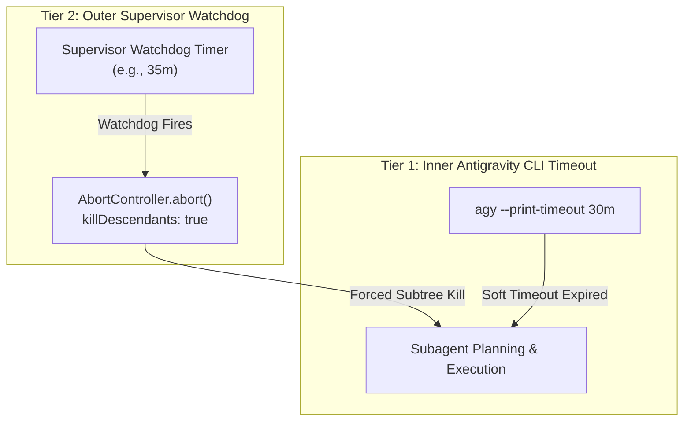
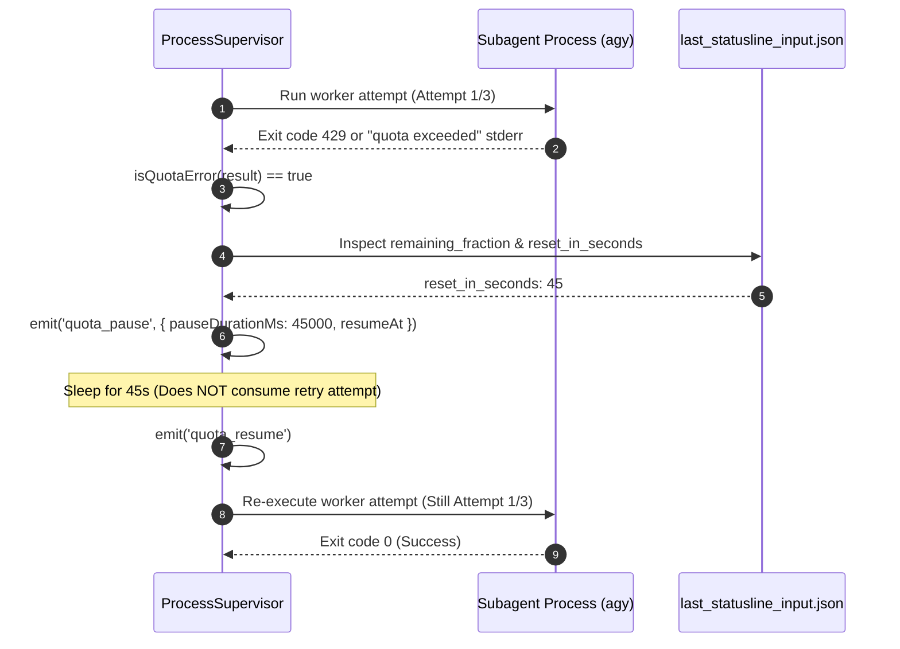
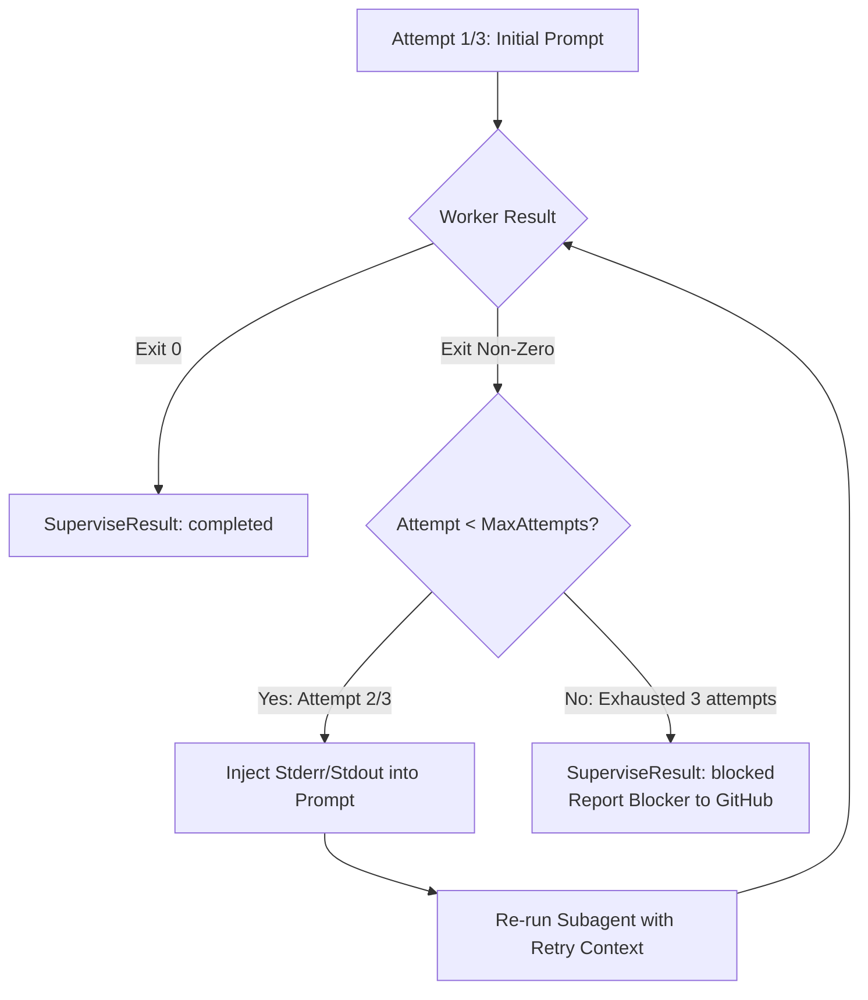

# Process Supervision (`ProcessSupervisor`)

The `ProcessSupervisor` ([`src/core/process-supervisor.ts`](file:///C:/Users/Manit/Desktop/sandcastle/src/core/process-supervisor.ts)) manages isolated AI subagent subprocess lifecycles in Sandcastle. It provides process safety, dual-tier watchdog timeouts, automatic retry loops with error feedback injection, and non-destructive HTTP 429 quota rate limit recovery.

---

## Context Pointers

| Document | Description | Reached When |
| :--- | :--- | :--- |
| [overview.md](file:///C:/Users/Manit/Desktop/sandcastle/docs/architecture/overview.md) | High-level system architecture and modular layer breakdown. | Seeking structural context. |
| [baton-orchestrator.md](file:///C:/Users/Manit/Desktop/sandcastle/docs/architecture/baton-orchestrator.md) | How `BatonRunner` invokes `ProcessSupervisor`. | Tracing end-to-end issue execution. |
| [antigravity-interop.md](file:///C:/Users/Manit/Desktop/sandcastle/docs/agents/antigravity-interop.md) | Antigravity (`agy`) CLI flags, model flags, and statusline formats. | Debugging CLI invocations or model arguments. |
| [programmatic-api.md](file:///C:/Users/Manit/Desktop/sandcastle/docs/developer/programmatic-api.md) | TypeScript API reference for `ProcessSupervisor` options and events. | Calling `ProcessSupervisor` programmatically. |

---

## Subprocess Lifecycle & Tree Termination

When executing an issue worker, `ProcessSupervisor` delegates subagent spawning to [`AntigravityService`](file:///C:/Users/Manit/Desktop/sandcastle/src/services/antigravity-service.ts), which wraps `execa`:

```typescript
const subprocess = execa(file, args, {
  ...execaOptions,
  ...(signal ? { cancelSignal: signal } : {}),
  killDescendants: true,
});
```

### Key Safety Guarantees
1. **`killDescendants: true`**: When an execution is aborted, times out, or fails, the entire process hierarchy (including build tools, node processes, and compilers launched by the subagent) is cleanly killed.
2. **Signal Trapping**: Intercepts `SIGINT` and `SIGTERM`, aborting the active controller and establishing a 5-second escalation timer (`escalationGracePeriodMs`) before forcing process exit (`process.exit(130)`).
3. **Cursor Restoration**: Guarantees cursor visibility (`\x1b[?25h`) is restored upon any abnormal or normal exit.

---

## Dual-Tier Timeout Architecture

Sandcastle implements a dual-tier timeout model to prevent runaway subagent processes and hung test runners:



### Tier 1: Inner CLI Timeout (`--print-timeout`)
- Configured via CLI flag `--timeout <duration>` (default: `30m`).
- Passed directly to the Antigravity CLI (`agy --print-timeout 30m`).
- Enables the underlying agent runtime to gracefully handle its own internal execution deadline.

### Tier 2: Outer Supervisor Watchdog (`outerTimeoutMs`)
- Managed directly inside `ProcessSupervisor`.
- Runs an independent watchdog timer outside the subagent process.
- If the inner process hangs or fails to terminate when its deadline arrives, the outer watchdog fires, emits `{ type: 'timeout', tier: 'outer' }`, aborts the `AbortController`, and terminates the process tree.

---

## HTTP 429 Quota Rate Limit Detection & Recovery

When running large backlogs, AI coding agents may encounter upstream LLM rate limits (HTTP 429 / `RESOURCE_EXHAUSTED`). Unlike ordinary execution failures, **rate limits do NOT indicate incorrect code or broken tests**.

`ProcessSupervisor` detects quota exhaustion, pauses execution without consuming a retry attempt, waits for quota reset, and automatically resumes:



### 1. Quota Error Detection (`isQuotaError`)
Evaluates the process result using exit codes and regex patterns:
```typescript
isQuotaError(result: { exitCode?: number; stderr?: string; stdout?: string }): boolean {
  if (result.exitCode === 429) {
    return true;
  }
  const combinedOutput = `${result.stderr || ''} ${result.stdout || ''}`;
  const quotaRegex =
    /(?:429|quota\s+exceeded|rate\s+limit|resource_exhausted|too\s+many\s+requests)/i;
  return quotaRegex.test(combinedOutput);
}
```

### 2. Delay Calculation (`resolveQuotaDelayMs`)
Reads `~/.gemini/antigravity-cli/last_statusline_input.json` to extract precise `reset_in_seconds`. If available, it sleeps for that exact duration (capped at 5 minutes). Otherwise, it falls back to a default 60-second backoff.

### 3. Non-Destructive Pause & Resume
- Emits `{ type: 'quota_pause', pauseDurationMs, resumeAt }`.
- Awaits the backoff timer.
- Emits `{ type: 'quota_resume' }`.
- Re-executes the current attempt **without incrementing the `attempt` counter**.

---

## Verification Failure Retry Loop

When a worker completes with a non-zero exit code (e.g. failing tests, compile errors, or unfulfilled acceptance criteria), `ProcessSupervisor` initiates an automated retry loop:



### Structured Feedback Injection
Before launching a retry attempt, `ProcessSupervisor` appends the exact compiler or test runner error feedback to the subagent prompt:

```text
[Sandcastle Retry Context - Attempt 2/3]
Previous attempt failed. Error output:
FAIL test/parser.test.ts
  ✕ should parse prerequisite issue numbers (Expected 2, received 1)

Please fix the issue and ensure all tests pass.
```

### Retry Configuration Defaults
- **Default Max Retries**: `2` (meaning `3` total attempts: 1 initial attempt + 2 retries).
- **Final Exhaustion**: If all 3 attempts fail, `ProcessSupervisor` emits `{ type: 'blocked' }` and returns `{ success: false, status: 'blocked' }`.
- `BatonRunner` then executes the Blocker Protocol, labeling the issue `status blocked` and posting the full diagnostic failure log to GitHub.

---

## Supervisor Event Interface (`SupervisorEvent`)

Subscribers can listen to structured supervisor events via the `onEvent` hook:

```typescript
export type SupervisorEvent =
  | { type: 'attempt_start'; attempt: number; maxAttempts: number; issueNumber: number }
  | { type: 'attempt_success'; attempt: number; issueNumber: number; durationMs: number }
  | {
      type: 'attempt_failed';
      attempt: number;
      maxAttempts: number;
      issueNumber: number;
      error: string;
      exitCode?: number;
    }
  | { type: 'quota_pause'; pauseDurationMs: number; reason: string; resumeAt: Date }
  | { type: 'quota_tick'; remainingMs: number }
  | { type: 'quota_resume' }
  | { type: 'timeout'; tier: 'inner' | 'outer'; durationMs: number }
  | { type: 'signal_abort'; signal: string; graceful: boolean }
  | { type: 'blocked'; issueNumber: number; reason: string; totalAttempts: number };
```
