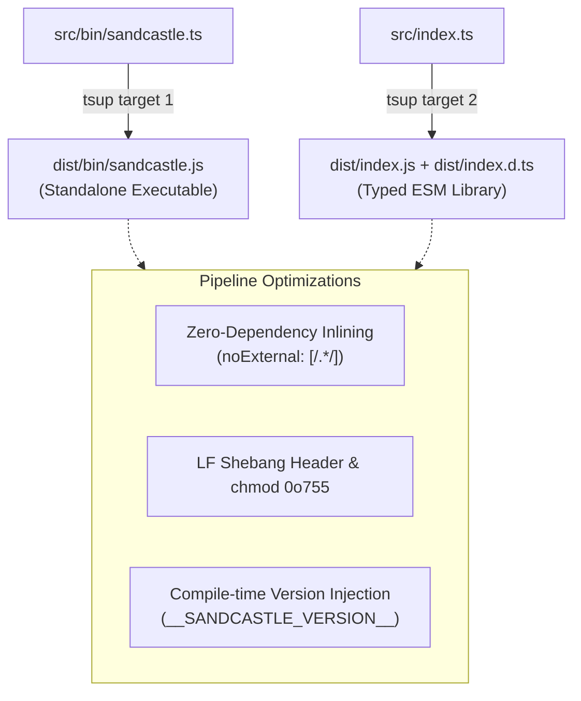

# Developer and Contributor Guide

This guide covers development workflows, build architectures, bundling pipelines, test suites, and prepack verification procedures for the Sandcastle codebase.

---

## Context Pointers

| Document | Description | Reached When |
| :--- | :--- | :--- |
| [overview.md](file:///C:/Users/Manit/Desktop/sandcastle/docs/architecture/overview.md) | High-level system architecture and modular layer breakdown. | Getting oriented with codebase architecture. |
| [programmatic-api.md](file:///C:/Users/Manit/Desktop/sandcastle/docs/developer/programmatic-api.md) | TypeScript API reference and exported classes. | Writing code against the public library API. |
| [cli-reference.md](file:///C:/Users/Manit/Desktop/sandcastle/docs/user/cli-reference.md) | CLI commands, flags, and JSON output formats. | Adding or modifying CLI subcommands. |

---

## Development Setup & Prerequisites

### Prerequisites
- **Node.js**: `>= 18.0.0` (LTS recommended)
- **npm**: `>= 9.0.0`
- **Git**: `>= 2.30.0`
- **GitHub CLI (`gh`)**: `>= 2.20.0` (authenticated via `gh auth login`)

### Setup Instructions

```bash
# 1. Clone repository
git clone https://github.com/Vudattumaniteja/sandcastle-baton-demo.git
cd sandcastle

# 2. Install dependencies
npm install

# 3. Build project artifacts
npm run build

# 4. Run test suites
npm test

# 5. Link binary locally for development testing
npm link
```

---

## Repository Structure

```text
sandcastle/
├── .agents/                      # Agent instruction rules and configs
├── bin/                          # CLI executable scripts
├── docs/                         # Comprehensive documentation
│   ├── adr/                      # Architecture Decision Records
│   ├── agents/                   # Agent guides (authoring, labels, interop)
│   ├── architecture/             # Engine architecture deep dives
│   ├── developer/                # Developer & API references
│   └── user/                     # User guides & CLI reference
├── scripts/                      # Build verification & maintenance scripts
│   └── verify-build.mjs          # Strict prepack artifact validator
├── src/                          # TypeScript source code
│   ├── bin/                      # CLI entrypoints
│   │   └── sandcastle.ts         # Dual binary entrypoint with TTY auto-wizard
│   ├── commands/                 # Commander.js subcommand adapters
│   │   ├── config.ts             # 'sandcastle config' (get, set, list)
│   │   ├── doctor.ts             # 'sandcastle doctor' environment diagnostics
│   │   ├── run.ts                # 'sandcastle run' headless baton loop
│   │   ├── status.ts             # 'sandcastle status' snapshot viewer
│   │   ├── watch.ts              # 'sandcastle watch' live monitor
│   │   └── wizard.ts             # 'sandcastle wizard' interactive TUI
│   ├── core/                     # Core baton engine
│   │   ├── baton-runner.ts       # State machine orchestrator
│   │   ├── gating-evaluator.ts   # 4-gate verification & prerequisite graph
│   │   ├── process-supervisor.ts # Subagent supervisor, timeouts & quota
│   │   └── transcript-tailer.ts  # JSONL stream poller & extractor
│   ├── services/                 # External CLI and config service adapters
│   │   ├── antigravity-service.ts# Antigravity (agy) CLI driver
│   │   ├── config-service.ts     # 3-tier config loader
│   │   ├── doctor-service.ts     # Health check diagnostics
│   │   └── github-service.ts     # GitHub (gh) CLI driver
│   ├── types/                    # TypeScript interfaces & event maps
│   ├── ui/                       # Terminal presentation & TUI
│   │   ├── formatters.ts         # Badges, progress bars & phase formatters
│   │   └── watch-monitor.ts      # Alternate-screen live dashboard
│   └── index.ts                  # Public typed library exports
├── test/                         # Vitest unit & integration test suite
├── package.json                  # Package configuration & exports
├── tsconfig.json                 # TypeScript compiler configuration
├── tsup.config.ts                # Dual-target bundling configuration
└── vitest.config.ts              # Vitest test runner configuration
```

---

## Bundling Pipeline (`tsup.config.ts`)

Sandcastle uses `tsup` to produce two optimized ESM artifacts from a single build pipeline:



### 1. Dual Build Targets
- **CLI Executable (`dist/bin/sandcastle.js`)**: Bundled with embedded runtime dependencies, enabling instant execution via `npx sandcastle` without downloading packages.
- **Typed Library (`dist/index.js` & `dist/index.d.ts`)**: Pure ESM library with TypeScript declaration files for programmatic consumption.

### 2. Zero-Dependency Inlining (`noExternal: [/.*/]`)
All runtime dependencies (`@clack/prompts`, `commander`, `execa`, `picocolors`, `sisteransi`) are bundled directly into `dist/bin/sandcastle.js`, avoiding module resolution issues across global Node installations.

### 3. LF Shebang Normalization & Permissions
On Windows systems, git or editors may convert line endings to CRLF. The build pipeline enforces standard LF shebang line endings:
```typescript
async onSuccess() {
  const binFile = path.resolve(__dirname, 'dist/bin/sandcastle.js');
  if (fs.existsSync(binFile)) {
    let content = fs.readFileSync(binFile, 'utf-8');
    content = content.replace(/\r\n/g, '\n');
    fs.writeFileSync(binFile, content, 'utf-8');
    try {
      fs.chmodSync(binFile, 0o755);
    } catch {}
  }
}
```

### 4. Compile-Time Version Injection
The package version from `package.json` is injected at build time via `__SANDCASTLE_VERSION__`, ensuring `sandcastle --version` never incurs runtime disk I/O.

---

## Running Tests & Typechecks

### 1. Unit & Integration Tests (Vitest)
```bash
# Run all tests once
npm test

# Run tests in watch mode during development
npm run test:watch
```

### 2. TypeScript Typechecking
```bash
# Verify zero type errors across the entire codebase
npm run typecheck
```

---

## Prepack Verification Pipeline (`verify-build.mjs`)

Before publishing to npm or creating release tags, Sandcastle executes [`scripts/verify-build.mjs`](file:///C:/Users/Manit/Desktop/sandcastle/scripts/verify-build.mjs) via `npm run build:verify` or `npm run prepack`.

```bash
npm run build:verify
```

### What `verify-build.mjs` Validates:
1. **`package.json` Metadata**: Confirms `"type": "module"`, `"engines.node": ">=18.0.0"`, and dual-binary paths (`"sandcastle"` and `"sc"` point to `./dist/bin/sandcastle.js`).
2. **Artifact Existence**: Verifies `dist/bin/sandcastle.js`, `dist/index.js`, and `dist/index.d.ts` exist.
3. **Shebang Format**: Ensures `dist/bin/sandcastle.js` starts with `#!/usr/bin/env node\n` using standard Unix LF line endings.
4. **CLI `--version` Smoke Test**: Executes `node dist/bin/sandcastle.js --version` and verifies output matches `package.json` version.
5. **CLI `--help` Smoke Test**: Executes `node dist/bin/sandcastle.js --help` and asserts standard command syntax.
6. **Programmatic Library Export**: Imports `dist/index.js` dynamically and checks `VERSION` constant export.
