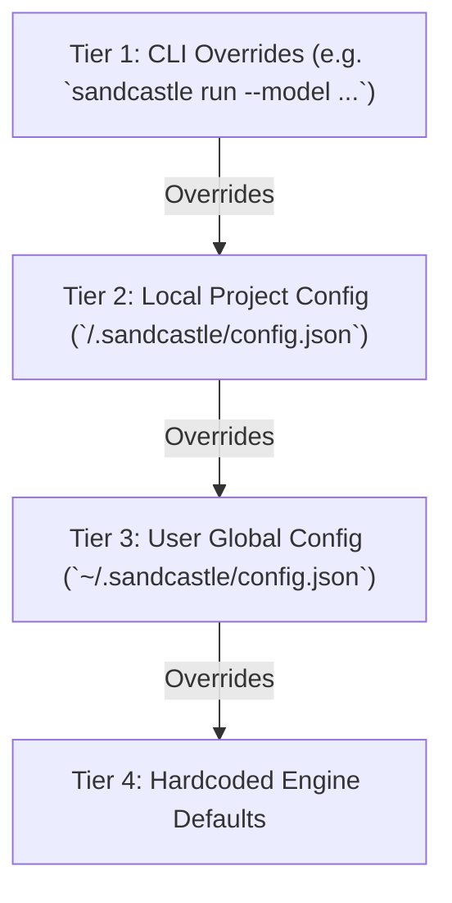

# Sandcastle Configuration Guide

Sandcastle utilizes a hierarchical 4-tier configuration system managed via [`ConfigService`](file:///C:/Users/Manit/Desktop/sandcastle/src/services/config-service.ts). This enables developers to declare persistent personal defaults, define team-wide repository policies, and override parameters per CLI invocation.

---

## The 4-Tier Configuration Hierarchy

Configuration values are resolved sequentially, where higher tiers override lower tiers:



| Tier | Source | Path / Invocation | Purpose |
| :---: | :--- | :--- | :--- |
| **1** | **CLI Overrides** | Terminal flags (e.g. `--model`, `--mode`) | Immediate, one-off command overrides. |
| **2** | **Local Project Config** | `<workspace>/.sandcastle/config.json` | Repository-specific team conventions, timeout thresholds, and policies. |
| **3** | **User Global Config** | `~/.sandcastle/config.json` | Developer-wide defaults across all repositories on the workstation. |
| **4** | **Hardcoded Defaults** | [`src/services/config-service.ts`](file:///C:/Users/Manit/Desktop/sandcastle/src/services/config-service.ts) | Safe fallback values built into the Sandcastle binary. |

---

## Configuration Schema & Keys

The table below details all supported configuration keys:

| Key | Type | Allowed Values | Hardcoded Default | Description |
| :--- | :--- | :--- | :--- | :--- |
| **`model`** | String | Any model name or alias (e.g. `Gemini 3.7 Flash`, `Gemini 3.1 Pro`, `Claude Sonnet 4.6 (Thinking)`) | `Gemini 3.7 Flash` | The LLM model backend passed to Antigravity worker processes. |
| **`reasoningEffort`** | String | `low`, `medium`, `high` | `high` | Reasoning effort depth passed to the model backend. |
| **`mode`** | String | `afk`, `supervised`, `dry-run` | `afk` | Execution autonomy mode (`afk` = unattended, `supervised` = prompt before git mutations, `dry-run` = simulate). |
| **`timeout`** | String | Valid duration string (e.g. `15m`, `30m`, `1h`) | `30m` | Watchdog timeout per issue before failing the attempt. |
| **`retries`** | Number | Integer `>= 0` | `2` | Number of automated retry attempts permitted per issue upon test/worker failure. |
| **`autoPr`** | Boolean | `true`, `false` | `true` | Automatically open a Pull Request upon verified local tests. |
| **`autoMerge`** | Boolean | `true`, `false` | `true` | Automatically merge the created Pull Request. |
| **`repo`** | String | `owner/repo` string | `""` *(auto-detected)* | Target GitHub repository. If omitted, automatically resolved from git remote. |

---

## Configuration CLI Commands

Sandcastle provides built-in CLI commands to query, modify, and inspect configuration tiers without manually editing JSON files.

### 1. `sandcastle config get <key>`

Displays the effective resolved value for a specific key:

```bash
# Get resolved model
sandcastle config get model
# Output: model: Gemini 3.7 Flash

# Output as JSON for scripts
sandcastle config get timeout --json
# Output: { "key": "timeout", "value": "30m" }
```

### 2. `sandcastle config set <key> <value> [--global]`

Updates a setting in either the local project config or user global config:

```bash
# Set repository-local config (.sandcastle/config.json)
sandcastle config set model "Gemini 3.1 Pro"
sandcastle config set reasoningEffort high
sandcastle config set timeout 45m

# Set user global config (~/.sandcastle/config.json)
sandcastle config set model "Gemini 3.7 Flash" --global
sandcastle config set autoMerge true -g
```

### 3. `sandcastle config list [--json]`

Inspects all configuration values across all tiers simultaneously:

```bash
sandcastle config list
```

Example terminal output:
```text
Sandcastle Configuration (3-Tier Resolution)
===============================================

Resolved Effective Config:
  model: Gemini 3.7 Flash
  reasoningEffort: high
  mode: afk
  timeout: 30m
  retries: 2
  autoPr: true
  autoMerge: true
  repo: Vudattumaniteja/sandcastle-baton-demo

Local Overrides (.sandcastle/config.json):
  model: Gemini 3.7 Flash
  timeout: 30m

Global Defaults (~/.sandcastle/config.json):
  reasoningEffort: high
  retries: 2
```

Using `--json` produces a structured object containing `defaults`, `global`, `local`, and `resolved` dictionaries.

---

## File Format Examples

### Local Project Config (`.sandcastle/config.json`)

Commit this file to your git repository to standardize settings for all contributors:

```json
{
  "model": "Gemini 3.7 Flash",
  "reasoningEffort": "high",
  "mode": "afk",
  "timeout": "30m",
  "retries": 2,
  "autoPr": true,
  "autoMerge": true
}
```

### User Global Config (`~/.sandcastle/config.json`)

Stored in your user home directory to configure default preferences across all projects:

```json
{
  "model": "Gemini 3.7 Flash",
  "reasoningEffort": "high",
  "timeout": "45m"
}
```

---

## Context Pointers & Related Guides

| Document | Description | Reached When |
| :--- | :--- | :--- |
| [getting-started.md](file:///C:/Users/Manit/Desktop/sandcastle/docs/user/getting-started.md) | Initial setup, installation, and environment health check. | Getting started with Sandcastle. |
| [cli-reference.md](file:///C:/Users/Manit/Desktop/sandcastle/docs/user/cli-reference.md) | Complete reference of all flags that override configuration tiers. | Using CLI flags to override configuration values. |
| [interactive-wizard.md](file:///C:/Users/Manit/Desktop/sandcastle/docs/user/interactive-wizard.md) | How the wizard consumes configuration defaults. | Selecting options inside the interactive wizard. |
| [antigravity-interop.md](file:///C:/Users/Manit/Desktop/sandcastle/docs/agents/antigravity-interop.md) | How configured models and effort levels are resolved for the Antigravity backend. | Configuring Antigravity models and quotas. |
