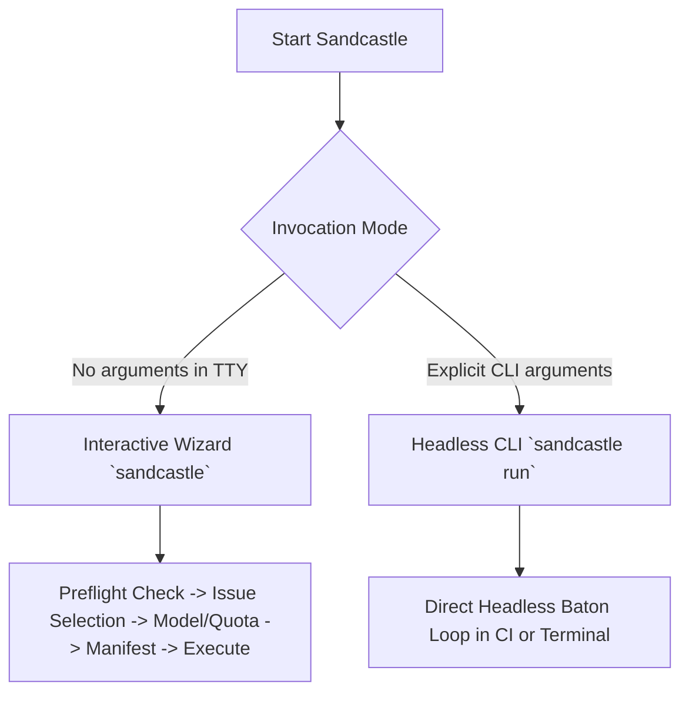

# Getting Started with Sandcastle

Sandcastle is a cross-platform, autonomous GitHub issue **baton** orchestrator for AI coding agents. It drives sequential, isolated execution where each issue is implemented, verified, merged, and closed by a dedicated **worker** session before advancing to the next ticket.

---

## Prerequisites

Before running Sandcastle, ensure your environment meets the following requirements:

| Component | Minimum Version | Verification Command | Notes |
| :--- | :--- | :--- | :--- |
| **Node.js** | `>= 18.0.0` | `node --version` | Required runtime for the TypeScript CLI engine. |
| **Git** | `>= 2.30.0` | `git --version` | Sandcastle must be executed inside a valid Git repository worktree. |
| **GitHub CLI (`gh`)** | `>= 2.20.0` | `gh auth status` | Authenticated session with repository read/write and PR permissions. |
| **Google Antigravity (`agy`)** | Any | `agy --version` | Local Antigravity CLI driver for spawning AI worker sessions. |

> [!NOTE]
> Run `sandcastle doctor` at any time to automatically diagnose and validate your environment against these prerequisites.

---

## Installation

You can install Sandcastle globally, link it locally for development, or run it ephemerally via `npx`.

### 1. Global Installation (Recommended)

```bash
npm install -g sandcastle
```

Both `sandcastle` and the shorthand alias `sc` will be available globally in your `PATH`.

### 2. Instant Run via `npx` (No Global Install)

```bash
npx sandcastle
```

Because Sandcastle is bundled as a zero-dependency standalone ESM binary, `npx sandcastle` executes immediately without downloading additional runtime packages.

### 3. Local Development Link

For contributors modifying the Sandcastle codebase:

```bash
git clone https://github.com/Vudattumaniteja/sandcastle-baton-demo.git
cd sandcastle
npm install
npm run build
npm link
```

---

## Environment Verification: `sandcastle doctor`

Verify that your workspace and toolchain are ready to execute autonomous batons:

```bash
sandcastle doctor
```

Example output:
```text
Sandcastle Environment Diagnostics (Doctor)
===============================================

  ✔ Node.js Runtime: Node.js v22.13.0 (Required >= 18.0.0)
  ✔ Git Workspace: Valid Git repository (Active branch: main)
  ✔ GitHub CLI Auth: GitHub CLI (gh) is authenticated and functional.
  ✔ Antigravity CLI (agy): Antigravity CLI is installed (Ready)
  ✔ Workspace Gate Assets: All required workspace assets present (SKILL.md, CONTEXT.md, AGENTS.md).

✔ System and workspace are healthy and ready for Sandcastle batons.
```

If any checks fail, `sandcastle doctor` prints exact remediation steps (e.g., `gh auth login`).

---

## Dual Invocation Paths

Sandcastle provides two complementary invocation models depending on your workflow:



### 1. Interactive Terminal Wizard (`sandcastle` or `sc`)

Running `sandcastle` without arguments in an interactive terminal launches the `@clack/prompts` wizard:

```bash
sandcastle
# or shorthand:
sc
```

The wizard guides you through:
1. Workspace preflight diagnostics.
2. Backlog issue browsing with color-coded **gate** badges (`[READY]`, `[WAITING]`, `[BLOCKED]`, `[UNGATED]`).
3. Antigravity model selection with live **quota** percentages and reset countdowns.
4. Reasoning effort level (`High`, `Medium`, `Low`).
5. Execution mode (`Autonomous AFK`, `Supervised`, `Dry Run`).
6. Launch manifest confirmation and multi-phase execution spinner.

See the [Interactive Wizard Guide](file:///C:/Users/Manit/Desktop/sandcastle/docs/user/interactive-wizard.md) for a complete walkthrough.

### 2. Headless CLI Engine (`sandcastle run`)

For scripting, cron schedules, CI/CD pipelines, or power users who prefer flags:

```bash
# Execute a single issue autonomously
sandcastle run 42

# Execute all open ready issues in backlog order
sandcastle run --all

# Run with explicit model and reasoning effort
sandcastle run 42 --model "Gemini 3.7 Flash" --effort high --mode afk

# Dry-run execution to verify gating without making changes
sandcastle run --all --mode dry-run
```

See the [CLI Reference](file:///C:/Users/Manit/Desktop/sandcastle/docs/user/cli-reference.md) for all subcommands and flags.

---

## Context Pointers & Related Guides

| Document | Description | Reached When |
| :--- | :--- | :--- |
| [interactive-wizard.md](file:///C:/Users/Manit/Desktop/sandcastle/docs/user/interactive-wizard.md) | In-depth walkthrough of the interactive TUI wizard flow, badges, and phase spinners. | Exploring interactive terminal workflows. |
| [cli-reference.md](file:///C:/Users/Manit/Desktop/sandcastle/docs/user/cli-reference.md) | Complete reference of all subcommands, options, exit codes, and JSON schemas. | Automating runs or configuring CLI pipelines. |
| [configuration.md](file:///C:/Users/Manit/Desktop/sandcastle/docs/user/configuration.md) | 4-tier configuration hierarchy, schema keys, and `sandcastle config` CLI commands. | Setting persistent local or global defaults. |
| [worker-contract.md](file:///C:/Users/Manit/Desktop/sandcastle/docs/agents/worker-contract.md) | The authoritative 7-phase execution protocol and blocker rules executed by worker agents. | Understanding or auditing worker behaviors. |
| [antigravity-interop.md](file:///C:/Users/Manit/Desktop/sandcastle/docs/agents/antigravity-interop.md) | Google Antigravity (`agy`) CLI integration, model resolution, and quota tracking. | Configuring model backends or subagent sessions. |
