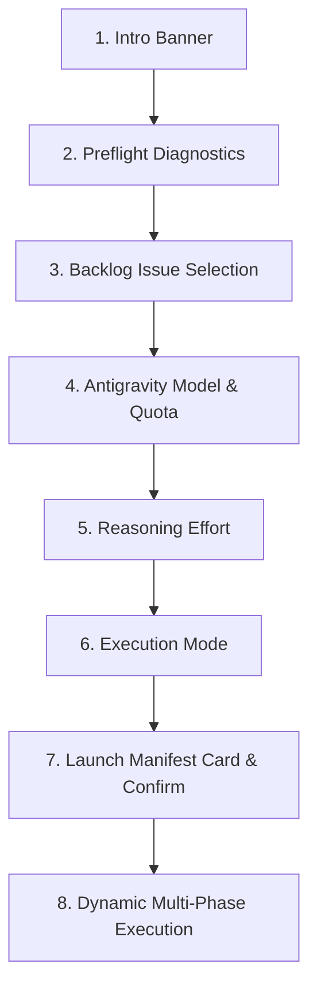

# Interactive Terminal Wizard Guide

The Sandcastle interactive terminal wizard provides a guided, visual terminal UI powered by `@clack/prompts`. It enables developers to inspect repository health, evaluate issue **gates**, review live **quota** status, select execution parameters, and monitor autonomous **worker** execution with dynamic phase spinners.

---

## Invoking the Wizard

Run Sandcastle without arguments in any interactive terminal (TTY) inside a Git repository:

```bash
sandcastle
# or shorthand alias:
sc
# or explicit command:
sandcastle wizard
```

---

## Step-by-Step Wizard Walkthrough

The wizard executes in 8 sequential stages:



---

### Step 1 & 2: Banner & Preflight Diagnostics

Upon launch, the wizard runs diagnostics via `DoctorService` ([`src/services/doctor-service.ts`](file:///C:/Users/Manit/Desktop/sandcastle/src/services/doctor-service.ts)) to verify prerequisites:

```text
┌  Sandcastle Autonomous Issue Baton Wizard
│
◇  Preflight validation passed.
```

The preflight check evaluates:
1. **Node.js Runtime**: Ensures version is `>= 18.0.0`.
2. **Git Workspace**: Verifies worktree validity and identifies the active branch.
3. **GitHub CLI Auth**: Checks authenticated status (`gh auth status`).
4. **Antigravity CLI**: Validates availability of `agy` in `PATH`.
5. **Workspace Gate Assets**: Confirms presence of [`SKILL.md`](file:///C:/Users/Manit/Desktop/sandcastle/SKILL.md), [`CONTEXT.md`](file:///C:/Users/Manit/Desktop/sandcastle/CONTEXT.md), and [`AGENTS.md`](file:///C:/Users/Manit/Desktop/sandcastle/AGENTS.md).

> [!CAUTION]
> If a fatal check fails (such as missing GitHub CLI authentication or non-git folder), the wizard halts with an error and prints remediation instructions.

---

### Step 3: Backlog Issue Selection & Gating Badges

The wizard fetches all open repository issues and runs them through the `GatingEvaluator` ([`src/core/gating-evaluator.ts`](file:///C:/Users/Manit/Desktop/sandcastle/src/core/gating-evaluator.ts)). Parent epics (`[PARENT]`) and Human-in-the-loop tickets (`[HITL]`) are automatically filtered out from the issue selection list.

Each runnable issue is presented with a color-coded **gate** badge:

| Gating Badge | Color | Evaluation Meaning | Prompt Hint |
| :--- | :--- | :--- | :--- |
| **`[READY]`** | Green | Issue is `OPEN`, labeled `ready-for-agent` + `AFK`, and has no open prerequisites. | *Ready for autonomous execution* |
| **`[WAITING]`** | Yellow | Issue has `ready-for-agent` + `AFK`, but depends on open blocker issues. | *Waiting on #12, #13* |
| **`[BLOCKED]`** | Red | Issue has `status blocked` label or explicit blocker condition. | *Blocked: test failure* |
| **`[UNGATED]`** | Dim | Missing required gating labels (`ready-for-agent` or `AFK`). | *Missing ready-for-agent, AFK* |
| **`[CLOSED]`** | Gray | Issue is already closed in GitHub tracker. | *Already closed* |

#### 2-Step Issue Selection Flow

1. **Top-Level Issue Picker**:
   - **`All Ready Issues (N ready)`**: Sets `scope: { type: 'all' }` and advances directly to model selection.
   - **Individual Issue (`#<num>`)**: Opens a follow-up action prompt.

2. **Follow-Up Scope Prompt**:
   - `Run only issue #<num>` (Default): Sets `scope: { type: 'only', targets: [num] }`.
   - `Resume backlog from #<num> onward`: Sets `scope: { type: 'from', target: num }`.

3. **Parent Context Prompt (for Child Tasks)**:
   - When executing issues linked to a parent/epic ticket (`Part of #<num>`), the wizard prompts:
     `Include parent context in worker prompts? [Yes / No]` (Default: `Yes`).

```text
? Select an issue to run with Sandcastle baton:
> All Ready Issues (3 ready) — Run all unblocked ready issues sequentially
  #42 Add JSON schema validation [READY] — Ready for autonomous execution
  #43 Implement retry watchdog [WAITING] — Waiting on #42
  #44 Refactor statusline parser [UNGATED] — Missing ready-for-agent, AFK

? Select execution scope for issue #42:
> Run only issue #42 — Run only this issue and halt
  Resume backlog from #42 onward — Run this issue and subsequent ready backlog issues sequentially

? Include parent context in worker prompts? (Y/n)
```

---

### Step 4: Antigravity Dynamic Model Discovery & Live Quota

The wizard queries available Antigravity models via `AntigravityService` ([`src/services/antigravity-service.ts`](file:///C:/Users/Manit/Desktop/sandcastle/src/services/antigravity-service.ts)) and reads live quota fractions and reset countdowns from `last_statusline_input.json`:

```text
? Select Antigravity LLM model:
> Gemini 3.7 Flash [Default] [84% quota] (Resets in 42m)
  Gemini 3.1 Pro [92% quota] (Resets in 115m)
  Claude Sonnet 4.6 (Thinking) [45% quota] (Resets in 18m)
  GPT-OSS 120B (Medium) [100% quota]
```

- **Quota Percentages**: Displayed inline as `[N% quota]` based on the active quota pool (`gemini-5h`, `3p-5h`, or model-specific quotas).
- **Reset Timers**: Displayed as `Resets in Xm` to give immediate visibility into rate limit windows before launching workers.

---

### Step 5: Reasoning Effort Selection

Configures the reasoning depth passed to the Antigravity worker session:

| Effort Level | Label & Hint | Ideal Use Case |
| :--- | :--- | :--- |
| **`high`** | `High [Recommended for AFK Coding]` — *Deep reasoning for complex implementation & debugging* | Default. Unattended autonomous issue implementation, TDD test authoring, and complex bug fixes. |
| **`medium`** | `Medium` — *Balanced reasoning speed and verification* | Standard features with well-defined APIs and existing test coverage. |
| **`low`** | `Low` — *Fast generation for simple, localized tasks* | Documentation updates, typo fixes, or small localized config changes. |

```text
? Select reasoning effort level:
> High [Recommended for AFK Coding] — Deep reasoning for complex implementation & debugging
  Medium — Balanced reasoning speed and verification
  Low — Fast generation for simple, localized tasks
```

---

### Step 6: Execution Mode Selection

Controls worker autonomy and approval boundaries:

| Mode | Label & Description | Interaction Behavior |
| :--- | :--- | :--- |
| **`afk`** | `Autonomous AFK` — *Full autonomy: implement, verify, PR, merge, close* | Unattended end-to-end execution. Worker runs the full 7-phase contract without human prompts. |
| **`supervised`** | `Supervised` — *Pause for user confirmation before git/PR mutations* | Prompts the user before creating branches, opening PRs, or executing merge actions. |
| **`dry-run`** | `Dry Run` — *Simulate gating & execution without modifying git or spawning agents* | Evaluates gates and simulates baton events without modifying repository or GitHub state. |

```text
? Select execution mode:
> Autonomous AFK — Full autonomy - implement, verify, PR, merge, close
  Supervised — Pause for user confirmation before git/PR mutations
  Dry Run — Simulate gating & execution without modifying git or spawning agents
```

---

### Step 7: Launch Manifest Note Card & Confirmation

Before any agent is spawned, the wizard presents a structured manifest summary note card with human-readable scope targets (`Single Issue (#42)`, `Backlog Resumption (from #42 onward)`, or `Full Backlog`):

```text
┌  Sandcastle Launch Manifest
│
│  Repository:      Vudattumaniteja/sandcastle-baton-demo
│  Active Branch:   main
│  Target:          Single Issue (#42)
│  Model:           Gemini 3.7 Flash (High)
│  Reasoning:       High
│  Mode:            Autonomous AFK
│  Auto PR/Merge:   Enabled / Enabled
│
└

? Launch Sandcastle Baton with this configuration? (Y/n)
```

Confirming (`Y` / Enter) transitions immediately to the dynamic execution phase. Declining (`n`) cancels the wizard without side effects.

---

### Step 8: Dynamic Multi-Phase Progress Spinners

During execution, the wizard renders dynamic animated terminal spinners that advance through the 6 worker contract phases ([`src/ui/formatters.ts`](file:///C:/Users/Manit/Desktop/sandcastle/src/ui/formatters.ts)):

```text
⠋ [1/6 Inspecting] Reading issue #42 requirements & context...
⠙ [2/6 Implementing] Writing minimal clean solution...
⠹ [3/6 Testing] Running test suites & linters...
⠸ [4/6 Git] Creating branch & committing changes...
⠼ [5/6 PR] Creating Pull Request...
⠴ [6/6 Merging] Merging Pull Request...
⠦ [Closing] Verifying closure & recording audit log...
```

#### Final Execution Outcomes:

- **Success**:
  ```text
  ✔ Issue #42 completed successfully in 48.2s
  ✔ Baton finished successfully! Closed 1 issue(s).
  
  └  Sandcastle Baton completed successfully! Closed 1 issue(s) in 48.2s.
  ```
- **Blocker Encountered**:
  ```text
  ✖ Issue #42 BLOCKED: Test suite failed with 2 errors in status.test.ts
  ✖ Baton halted due to blockers (1 blocked issue(s)).
  
  └  Sandcastle Baton halted to protect repository integrity.
  ```

---

## Context Pointers & Related Documentation

| Document | Description | Reached When |
| :--- | :--- | :--- |
| [getting-started.md](file:///C:/Users/Manit/Desktop/sandcastle/docs/user/getting-started.md) | Initial setup, prerequisites, and global installation. | Setting up Sandcastle for the first time. |
| [cli-reference.md](file:///C:/Users/Manit/Desktop/sandcastle/docs/user/cli-reference.md) | Full manual of flags for non-interactive `sandcastle run` and headless automation. | Transitioning from wizard to automated headless runs. |
| [configuration.md](file:///C:/Users/Manit/Desktop/sandcastle/docs/user/configuration.md) | Pre-configuring default model, effort, and mode for the wizard. | Customizing wizard initial choices permanently. |
| [worker-contract.md](file:///C:/Users/Manit/Desktop/sandcastle/docs/agents/worker-contract.md) | Deep specification of the 7 worker execution phases displayed by the spinners. | Auditing the exact steps executed during each phase. |
